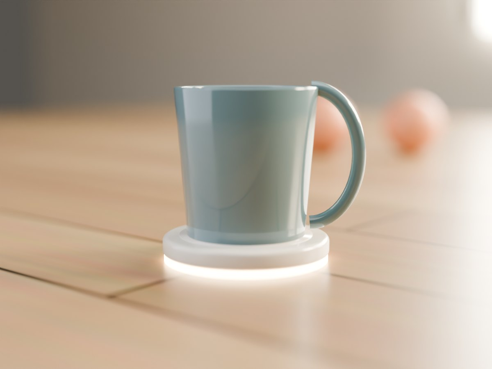

# Semana 6
## Generación y Selección de Concepto de Diseño
# Semana 6 — Generación y Selección de Concepto de Diseño

**Tema:** DistanciaCero — Tabla morfológica, analogías tecnológicas, 3 conceptos de diseño, Matriz de Pugh y boceto técnico crítico
**Fecha:** 01/10/2026 · Actualizado 22/10/2026 (prompts y respuestas completos en la página, más imágenes de los tres prototipos)
**Blueprint:** Creación de valor
**DVF:** 🔴 Deseable · 🟢 Factible

---

## 1. Objetivo de la actividad

Esta semana el equipo pasa de "qué debe hacer el producto" (PDS, semana 5) a "cómo se ve, cómo se toca y cómo se usa" (concepto de diseño). No es decoración — es la primera decisión que el usuario va a juzgar antes de entender cómo funciona el producto por dentro.

La actividad sigue un flujo de 6 prompts en secuencia: tabla morfológica → analogías tecnológicas → 3 conceptos de diseño completos → prompts de render → Matriz de Pugh para elegir → crítica técnica del boceto del concepto ganador. Después agregué dos prompts más: uno para generar una imagen realista de cada prototipo (Prompt 7) y otro para diseñar la interfaz de la app en Figma Make (Prompt 8).

---

## 2. Contexto del producto

- **Restricciones del PDS relevantes para el diseño:** uso en interior sin exigencia de IP alta; presupuesto de manufactura ~$800-1,100 MXN por unidad; instalación por el hijo/a en ≤10 min sin participación del adulto mayor (RI-03, RR-02); el componente más grande del hardware interno es el módulo celular SIM7600E-H + batería 18650, lo que impone un volumen mínimo a cualquier carcasa.
- **Punto de partida:** el producto se describe desde semana 2 integrado en "un objeto cotidiano (bastón, sillón, taza)" sin haber decidido cuál ni cómo. Esta semana convierte esa frase en tres conceptos concretos y elige uno con criterios explícitos.

---

## 3. Desarrollo: mis prompts y las respuestas de la IA

Trabajé con una sola IA, **Claude**. Abajo está cada prompt tal como lo usé y la respuesta completa que recibí. Las respuestas se despliegan con un clic.


---

### Prompt 1 — Tabla morfológica

**IA utilizada:** Claude — rol de diseñador industrial especializado en productos de hardware conectado para mercados latinoamericanos, con sesgo hacia opciones construibles con medios universitarios.

??? question "Mi prompt (clic para desplegar)"
    ```text
    Actúa como diseñador industrial especializado en productos de
    hardware conectado para mercados latinoamericanos. Tu sesgo es
    hacia opciones construibles con medios universitarios — nada
    que no pueda salir de un laboratorio con impresora 3D, CNC
    básica y acceso a componentes en México.

    Producto: DistanciaCero — sistema que detecta pasivamente la
    rutina diaria de un adulto mayor que vive solo, integrado en un
    objeto cotidiano, notificando al hijo/a solo por excepción.
    Usuario y contexto: adulto mayor 65+ en su propia casa (objeto
    anfitrión) + hijo/a 35-55 que instala y monitorea desde la app.

    Restricciones del PDS relevantes:
    · Resistencia ambiental: interior, IP54 razonable
    · Presupuesto de manufactura: ~$800-1,100 MXN/unidad
    · Instalación: por el hijo/a en ≤10 min, sin participación del
      adulto mayor
    · Dimensiones mínimas: deben alojar un módulo celular
      SIM7600E-H (~30×30mm) + batería 18650 (18mm × 65mm)

    Genera tabla morfológica con 7 parámetros, 3 variantes cada
    uno, cada variante fabricable con los medios del equipo.
    ```

??? example "Respuesta de Claude (clic para desplegar)"
    ════════════════════════════════════════════════════════
    **TABLA MORFOLÓGICA — DistanciaCero**
    ════════════════════════════════════════════════════════

    | Parámetro | Variante A | Variante B | Variante C |
    |---|---|---|---|
    | Objeto anfitrión | Bastón (impresión 3D + inserto) | Sillón/silla — módulo adherido bajo cojín o brazo (impresión 3D + sobremoldeo) | Taza/posavasos — cápsula removible (impresión 3D) |
    | Forma de la carcasa | Cilíndrica integrada al eje (impresión 3D por tramos) | Placa delgada rectangular redondeada (impresión 3D + sobremoldeo) | Cápsula circular plana removible (impresión 3D) |
    | Método de instalación | Inserto deslizante dentro del bastón (ajuste a presión impreso) | Velcro industrial bajo el cojín (adhesivo, sin proceso) | Adhesivo/magnético bajo la taza o posavasos (imanes de neodimio embebidos) |
    | Indicador de estado | LED tipo detector de humo, parpadeo breve periódico (LED en PCB + difusor impreso) | Sin indicador físico — todo en app (sin proceso) | Anillo luminoso tenue en la base (LED SMD + guía de luz impresa) |
    | Material y acabado | ABS acabado "madera" mate (impresión 3D, lijado y pintura) | Silicona suave, textura de tapicería (sobremoldeo en molde impreso) | Acabado "cerámico" satinado (impresión en resina + pintura epóxica) |
    | Interfaz física | Sin botones — automático (sin proceso) | Botón único de reset recesado (pulsador SMD + orificio) | Touch capacitivo oculto (pad de cobre en la PCB) |
    | Fuente de energía | Batería 18650 removible, acceso por tapa inferior (tapa impresa con rosca) | Batería 18650, acceso por panel trasero (tapa a presión impresa) | Batería sellada, reemplazo de cápsula completa (ensamble por pegado) |

    ════════════════════════════════════════════════════════


---

### Prompt 2 — Analogías tecnológicas

**IA utilizada:** Claude — rol de consultor de innovación de diseño especializado en transferencia de soluciones entre sectores.

??? question "Mi prompt (clic para desplegar)"
    ```text
    Actúa como consultor de innovación de diseño con experiencia
    en transferencia de soluciones entre sectores. No buscas
    inspiración estética — buscas mecanismos de interacción,
    formas de instalación y lógicas de feedback que ya funcionaron
    en otro contexto.

    Producto: DistanciaCero. Usuario: adulto mayor 65+ que no debe
    sentir vigilancia activa + hijo/a que sí necesita señal de que
    el aparato funciona.

    Tabla morfológica adjunta [Prompt 1]:
    PARÁMETRO | VARIANTE A | VARIANTE B | VARIANTE C
    Objeto anfitrión | Bastón (impresión 3D + inserto) | Sillón/silla (módulo adherido bajo cojín o brazo) | Taza/posavasos (cápsula removible)
    Forma de la carcasa | Cilíndrica integrada al eje | Placa delgada rectangular redondeada | Cápsula circular plana removible
    Método de instalación | Inserto deslizante dentro del bastón | Velcro industrial bajo el cojín | Adhesivo/magnético bajo la taza o posavasos
    Indicador de estado | LED tipo detector de humo (parpadeo breve periódico) | Sin indicador físico — todo en app | Anillo luminoso tenue en la base
    Material y acabado | ABS acabado "madera" mate | Silicona suave, textura de tapicería | Acabado "cerámico" satinado
    Interfaz física | Sin botones — automático | Botón único de reset recesado | Touch capacitivo oculto
    Fuente de energía | Batería 18650 removible, tapa inferior | Batería 18650, panel trasero | Batería sellada, reemplazo de cápsula completa

    Parámetros donde quiero más inspiración:
    - Indicador de estado (evitar ansiedad, dar confirmación sin
      sentirse como vigilancia)
    - Material y acabado (evitar que se sienta como dispositivo
      médico)
    - Fuente de energía (cero acción del adulto mayor — RR-02)

    Para cada uno, encuentra 2 productos de sectores
    completamente distintos que resuelvan el mismo problema de
    experiencia, y cómo trasplantar la lógica.
    ```

??? example "Respuesta de Claude (clic para desplegar)"
    ════════════════════════════════════════════════════════
    **ANALOGÍAS TECNOLÓGICAS — DistanciaCero**
    ════════════════════════════════════════════════════════

    **PARÁMETRO: Indicador de estado**
    **Problema de experiencia:** el hijo/a necesita saber que el aparato funciona; el adulto mayor no debe sentirse vigilado ni angustiarse por una luz que "pide atención".

    **Analogía 1: detector de humo doméstico · Sector: seguridad del hogar**
    - **Problema que resuelve:** confirmar que el aparato está vivo sin que el usuario tenga que hacer nada ni pensar en él.
    - **Lógica de solución:** un parpadeo muy breve y espaciado en uso normal (casi imperceptible), y una señal prominente (luz fija + sonido) solo ante falla real. La señal de "estoy bien" es discreta; la de "algo anda mal" es inconfundible.
    - **Trasplante posible:** el artefacto no muestra nada continuo; solo un destello verde corto en la instalación y, si fallara la conexión, una señal clara en la app del hijo/a.

    **Analogía 2: anillo inteligente Oura · Sector: wearables de salud de consumo**
    - **Problema que resuelve:** monitorear a una persona todo el día sin que el objeto se vea ni se sienta como aparato de monitoreo.
    - **Lógica de solución:** el objeto casi no tiene interfaz; toda la información vive en la app del teléfono y el objeto físico se limita a existir y recoger datos.
    - **Trasplante posible:** eliminar el indicador físico (Variante B de la tabla): la confirmación de que todo funciona vive 100 % en la app del hijo/a, nunca en el objeto del adulto mayor.

    ────────────────────────────────────────────────────────
    **PARÁMETRO: Material y acabado**
    **Problema de experiencia:** evitar que el objeto se lea como dispositivo médico o "gadget" técnico.

    **Analogía 1: bastones de gama alta · Sector: accesorios y moda para movilidad**
    - **Problema que resuelve:** un auxiliar de movilidad que el usuario no se avergüenza de llevar.
    - **Lógica de solución:** acabados de madera y torneados con proporciones de mueble, que lo sitúan como objeto personal y no como producto ortopédico.
    - **Trasplante posible:** acabado "madera" mate en el bastón y, por extensión, acabado que imite la tapicería en el sillón.

    **Analogía 2: electrodomésticos de cocina estilo retro · Sector: línea blanca / pequeños electrodomésticos**
    - **Problema que resuelve:** que una máquina técnica (refrigerador, tostador) se perciba cálida y doméstica en lugar de industrial.
    - **Lógica de solución:** curvas generosas, colores cálidos y acabados satinados en vez del lenguaje de "gadget" con aristas y plástico negro.
    - **Trasplante posible:** radios grandes en esquinas y acabado satinado cálido (cerámico, silicona suave) en todas las variantes.

    ────────────────────────────────────────────────────────
    **PARÁMETRO: Fuente de energía**
    **Problema de experiencia:** cero acción del adulto mayor (RR-02) — nada de cargar ni cambiar batería.

    **Analogía 1: base de carga por inducción de cepillo eléctrico · Sector: cuidado personal**
    - **Problema que resuelve:** recargar sin que el usuario conecte ningún cable.
    - **Lógica de solución:** el objeto se apoya en un soporte donde siempre se guarda y se carga solo, por contacto o inducción; el hábito ya existe (guardar el cepillo), la carga se monta encima.
    - **Trasplante posible:** soporte fijo donde el bastón siempre se guarda, con carga por contacto magnético; el único hábito es "dejarlo en su sitio".

    **Analogía 2: cámaras de seguridad con batería de larga duración · Sector: seguridad del hogar**
    - **Problema que resuelve:** operar meses sin intervención del usuario final.
    - **Lógica de solución:** la energía se gestiona con mantenimiento espaciado y programado (alguien cambia la batería cada cierto tiempo), no con una carga diaria.
    - **Trasplante posible:** el hijo/a, no el adulto mayor, cambia o recarga la batería cada 15-20 días, con acceso fácil (cápsula o tapa).

    ────────────────────────────────────────────────────────
    **VARIANTE SUGERIDA PARA AGREGAR A LA TABLA:**
    **Parámetro:** Fuente de energía
    **Variante nueva:** carga por contacto magnético en soporte fijo (manufactura: soporte impreso en 3D con pines pogo y imán de neodimio)
    **Viene de:** la base de carga del cepillo eléctrico
    ════════════════════════════════════════════════════════


---

### Prompt 3 — Los 3 conceptos de diseño

**IA utilizada:** Claude — rol de diseñador industrial y UX designer, articulando el sistema completo de tres componentes (artefacto, app y landing page).

??? question "Mi prompt (clic para desplegar)"
    ```text
    Actúa como diseñador industrial y UX designer. Articula
    conceptos de diseño completos para los tres componentes del
    producto, de forma que cada uno refuerce la misma propuesta
    de valor.

    Producto: DistanciaCero
    Propuesta de valor: "Para hijos que viven lejos de su padre o
      madre mayor, DistanciaCero reemplaza el miedo a 'la llamada'
      por la certeza diaria de que todo está bien — sin preguntar,
      sin culpa."

    Tabla morfológica final [con variantes de Prompt 1 y 2]:
    PARÁMETRO | VARIANTE A | VARIANTE B | VARIANTE C
    Objeto anfitrión | Bastón (impresión 3D + inserto) | Sillón/silla (módulo adherido bajo cojín o brazo) | Taza/posavasos (cápsula removible)
    Forma de la carcasa | Cilíndrica integrada al eje | Placa delgada rectangular redondeada | Cápsula circular plana removible
    Método de instalación | Inserto deslizante dentro del bastón | Velcro industrial bajo el cojín | Adhesivo/magnético bajo la taza o posavasos
    Indicador de estado | LED tipo detector de humo (parpadeo breve periódico) | Sin indicador físico — todo en app | Anillo luminoso tenue en la base
    Material y acabado | ABS acabado "madera" mate | Silicona suave, textura de tapicería | Acabado "cerámico" satinado
    Interfaz física | Sin botones — automático | Botón único de reset recesado | Touch capacitivo oculto
    Fuente de energía | Batería 18650 removible, tapa inferior | Batería 18650, panel trasero · carga por contacto magnético en soporte fijo | Batería sellada, reemplazo de cápsula completa

    CONCEPTO 1 — Bastón: cilíndrico integrado, inserto deslizante,
      LED tipo detector de humo, acabado madera, sin botones,
      batería con carga por contacto magnético.
    CONCEPTO 2 — Sillón: placa delgada, velcro bajo cojín, sin
      indicador físico, silicona neutra, botón único recesado,
      batería con acceso por panel trasero.
    CONCEPTO 3 — Taza: cápsula removible, adhesivo/magnético,
      anillo luminoso tenue, acabado cerámico, touch capacitivo
      oculto, batería sellada.

    Desarrolla para cada uno: artefacto (instalación, uso
    cotidiano, principios activos), app (pantalla principal) y
    landing page (headline, visual, CTA).
    ```

??? example "Respuesta de Claude (clic para desplegar)"
    ════════════════════════════════════════════════════════
    **CONCEPTO 1 — "El Bastón Centinela"**
    **Combinación morfológica:** Bastón · cilíndrico integrado · inserto deslizante · LED tipo detector de humo · acabado madera · sin botones · carga por contacto magnético
    ════════════════════════════════════════════════════════

    **ARTEFACTO**

    **Instalación:**
    1. Insertar el módulo en la base del bastón hasta oír el clic.
    2. Colocar el bastón en su soporte de carga (solo encaja en una posición).
    3. Esperar la luz verde breve.
    4. Escanear el código QR del soporte con la app.

    **Uso cotidiano:** se usa como un bastón normal. El único cambio de hábito es guardarlo siempre en su soporte, que también lo carga. Nunca hay que cargar nada por separado.

    **Principios activos:** Affordances (el soporte solo encaja en una orientación) · Contour bias (torneado sin aristas) · Confirmación (LED breve solo en instalación).

    **APP**
    - **Normal:** ícono de bastón en verde + "Todo tranquilo hoy".
    - **Alerta:** ícono en rojo + "Mamá no se ha movido en las últimas 3 horas".
    - **Acción principal:** "Llamar ahora".
    - **Omisión deliberada:** sin gráficas de movimiento ni datos crudos; un número de pasos o minutos convertiría la app en un tablero de vigilancia.

    **LANDING PAGE**
    - **Headline:** "El bastón de tu mamá ahora también cuida de ti."
    - **Visual principal:** bastón de madera en su soporte junto a una ventana con luz natural, sin elementos tecnológicos visibles.
    - **CTA:** "Quiero tranquilidad diaria."

    ────────────────────────────────────────────────────────
    **CONCEPTO 2 — "El Reposabrazos Centinela"**
    **Combinación morfológica:** Sillón · placa delgada · velcro bajo cojín · sin indicador físico · silicona neutra · botón único recesado · batería con acceso por panel trasero
    ════════════════════════════════════════════════════════

    **ARTEFACTO**

    **Instalación:**
    1. Elegir el sillón donde pasa más tiempo tu mamá/papá.
    2. Levantar el cojín del asiento.
    3. Pegar el módulo con el velcro incluido (solo cabe en una posición).
    4. Regresar el cojín a su lugar.
    5. Confirmar en la app que detectamos el peso al sentarse.

    **Uso cotidiano:** completamente invisible. El adulto mayor se sienta como siempre, sin saber que el sensor está ahí. No hay nada que recordar, cargar ni tocar.

    **Principios activos:** Constraints (el velcro solo cabe en una posición) · Costo-beneficio (LED eliminado a propósito, refuerza discreción) · Consistencia (el acabado imita la tapicería).

    **APP**
    - **Normal:** check verde grande + "Todo bien, se ha movido normalmente hoy".
    - **Alerta:** aviso rojo + "No detectamos actividad desde las 2:00pm".
    - **Acción principal:** "Ver detalle" (y "Llamar ahora" en alerta).
    - **Omisión deliberada:** no revela bajo qué cojín específico está el sensor, para proteger la privacidad y no generar ansiedad por "¿se habrá movido el sensor?".

    **LANDING PAGE**
    - **Headline:** "Sabrás que está bien sin tener que preguntarle."
    - **Visual principal:** sillón cómodo y acogedor en una sala familiar, sin ningún dispositivo visible.
    - **CTA:** "Ver cómo funciona."

    ────────────────────────────────────────────────────────
    **CONCEPTO 3 — "El Posavasos Guardián"**
    **Combinación morfológica:** Taza/posavasos · cápsula removible · adhesivo/magnético · anillo luminoso tenue · acabado cerámico · touch capacitivo oculto · batería sellada
    ════════════════════════════════════════════════════════

    **ARTEFACTO**

    **Instalación:**
    1. Colocar el posavasos donde se toma el café o el té.
    2. Tocar el centro una vez.
    3. Confirmar que el anillo se ilumina.
    4. Vincularlo en la app.

    **Uso cotidiano:** se usa como cualquier posavasos. El anillo se ilumina tenue al detectar uso, sin delatar su función real. Cuando la batería se agota se reemplaza la cápsula completa.

    **Principios activos:** Affordances (la forma circular invita a poner la taza, sin instrucción) · Confirmación (anillo inmediato pero ambiguo a propósito) · Contour bias (completamente circular).

    **APP**
    - **Normal:** taza llena en verde + "Desayunó esta mañana, como siempre".
    - **Alerta:** taza vacía/gris + "Hoy no ha usado su posavasos todavía".
    - **Acción principal:** "Ver detalle".
    - **Omisión deliberada:** no muestra el conteo de usos en el día, solo el primero relevante; contar tazas sería vigilancia, no tranquilidad.

    **LANDING PAGE**
    - **Headline:** "Un café, una señal de que todo está bien."
    - **Visual principal:** taza humeante sobre el posavasos en una cocina cálida, luz de mañana.
    - **CTA:** "Empezar hoy."
    ════════════════════════════════════════════════════════

---

### Prompt 4 — Prompts de render para Midjourney e Imagen 3

**IA utilizada:** Claude — rol de director de arte especializado en prompts de render para diseño industrial, con conocimiento de la sintaxis de Midjourney v6 e Imagen 3.

??? question "Mi prompt (clic para desplegar)"
    ```text
    Actúa como un director de arte con experiencia en crear prompts
    de render para herramientas de IA generativa de imagen aplicadas
    al diseño industrial de producto. Conoces la sintaxis y las
    fortalezas de Midjourney v6 (descriptores en cadena, parámetros
    al final) y de Imagen 3 de Google (lenguaje descriptivo fluido).

    INFORMACIÓN DEL EQUIPO (DistanciaCero):
    Usuario: adulto mayor 65+ que vive solo, en su casa.
    Entorno físico de uso: sala, cocina y recámara de una casa
      mexicana de clase media, interior.
    Nivel de sofisticación tecnológica del usuario: bajo — el
      objeto no debe verse como electrónica de consumo ni como
      dispositivo médico.

    Los 3 conceptos de diseño (Prompt 3):
    · Bastón Centinela — cilíndrico ∅~25mm, ABS acabado madera
      mate, inserto deslizante, soporte de carga con contacto
      magnético, LED verde breve solo en instalación.
    · Reposabrazos Centinela (sillón) — placa 90×60mm, silicona
      gris topo, velcro bajo el cojín, sin LED, sin botones visibles.
    · Posavasos Guardián — cápsula circular ∅~100mm, acabado
      cerámico satinado, anillo luminoso tenue en la base.

    Analogías que inspiraron el diseño (Prompt 2): detector de
    humo, anillo Oura, bastones de gama alta, electrodomésticos
    retro, base de carga de cepillo eléctrico.
    Contour bias: muy redondeado en los tres.
    Ángulo de render preferido: tres cuartos, en contexto de uso.

    Genera, para cada concepto, un prompt para Midjourney v6 y uno
    para Imagen 3, listos para copiar y pegar, con una línea de por
    qué funciona cada uno y 3 preguntas concretas para evaluar el
    render (affordances, contour bias, confirmación).
    ```

??? example "Respuesta de Claude (clic para desplegar)"
    ════════════════════════════════════════════════════════
    **CONCEPTO 2 — Reposabrazos Centinela (sillón)**
    ════════════════════════════════════════════════════════

    **PROMPT PARA MIDJOURNEY v6**

    ```text
    soft silicone rectangular sensor pad, neutral taupe color, seamless integration under armchair cushion fabric, no visible electronics, gentle rounded edges 4mm radius, warm living room lighting, three-quarter view, photorealistic product render, minimal, no text, no logos --ar 4:3 --style raw --v 6
    ```

    *Por qué funciona:* "no visible electronics" y "no text, no logos" frenan la tendencia de Midjourney a añadir pantallas o botones; el radio de 4 mm y "seamless" fijan el contour bias.

    **PROMPT PARA IMAGEN 3**

    ```text
    A soft silicone pad in neutral grey, roughly the size of a hand, with gently rounded edges and a matte upholstery-like texture, photographed at a three-quarter angle as it would sit tucked under the cushion of a cozy armchair in a warm living room. No visible buttons, lights, or electronic ports. Soft natural daylight, shallow depth of field.
    ```

    *Por qué funciona:* Imagen 3 respeta mejor un objeto industrial específico ("no visible buttons, lights, or ports") y no lo embellece con formas no pedidas.

    ────────────────────────────────────────────────────────
    **CONCEPTO 1 — Bastón Centinela**
    ════════════════════════════════════════════════════════

    **PROMPT PARA MIDJOURNEY v6**

    ```text
    elegant walking cane in matte wood finish, smooth turned cylindrical shaft, curved handle, standing in a small round charging stand with a tiny green indicator light, warm window light, Mexican living room, minimal, no visible electronics on the cane, photorealistic product render, three-quarter view, no text, no logos --ar 3:4 --style raw --v 6
    ```

    *Por qué funciona:* "no visible electronics on the cane" evita que Midjourney dibuje sensores o pantallas; el único elemento tecnológico permitido es el soporte con su luz verde.

    **PROMPT PARA IMAGEN 3**

    ```text
    A matte wooden walking cane with a smooth turned shaft and a rounded hook handle, standing upright in a low circular charging stand with a single small green light. The cane looks like a normal, well-made household object, not a medical device. Warm side light from a window, softly blurred living room in the background.
    ```

    *Por qué funciona:* el lenguaje descriptivo fluido ayuda a Imagen 3 a mantener el bastón "normal" y a no inventar mecanismos en el mango.

    ────────────────────────────────────────────────────────
    **CONCEPTO 3 — Posavasos Guardián**
    ════════════════════════════════════════════════════════

    **PROMPT PARA MIDJOURNEY v6**

    ```text
    round satin ceramic coaster with a faint warm glowing ring at its base, ceramic mug resting on top, light oak kitchen table, soft morning window light, shallow depth of field, minimal, no buttons, no text, no logos, photorealistic product render, low three-quarter view --ar 4:3 --style raw --v 6
    ```

    *Por qué funciona:* "faint warm glowing ring" limita el brillo a un anillo tenue, no a una lámpara; "no buttons" respeta el touch capacitivo oculto.

    **PROMPT PARA IMAGEN 3**

    ```text
    A round satin-finish ceramic coaster, about 10 centimeters wide, with a soft warm light ring glowing faintly underneath its edge. A blue-green ceramic mug sits on it on a light oak kitchen table. Soft morning light from a window behind, shallow depth of field, calm domestic mood. No visible buttons or screens.
    ```

    *Por qué funciona:* Imagen 3 mantiene las proporciones del objeto (≈10 cm) y la luz tenue sin exagerar el efecto.

    ════════════════════════════════════════════════════════
    **QUÉ EVALUAR EN EL RENDER**
    ════════════════════════════════════════════════════════
    1. **Affordances:** ¿se entiende sin instrucciones dónde se pone el objeto o qué se hace con él (el cojín sobre la placa, la taza sobre el anillo, el bastón en su soporte)?
    2. **Contour bias:** ¿hay alguna arista viva que lo haga ver "industrial"? Los radios deben leerse suaves en los tres conceptos.
    3. **Confirmación:** ¿el indicador (LED verde, anillo tenue, o ninguno) se ve discreto y no como alarma ni como dispositivo médico?
    ════════════════════════════════════════════════════════


---

### Prompt 5 — Matriz de Pugh

**IA utilizada:** Claude — rol de ingeniero de producto especializado en selección de concepto, asegurando balance entre deseabilidad (≥40 % del peso) y factibilidad.

??? question "Mi prompt (clic para desplegar)"
    ```text
    Actúa como ingeniero de producto con experiencia en Matriz de
    Pugh. No permitas que la matriz esté dominada por criterios
    técnicos.

    3 conceptos:
    CONCEPTO 1 — Bastón Centinela: bastón de madera sintética con el
      módulo insertado en la base; se guarda en un soporte que lo
      carga por contacto magnético. LED verde solo en instalación.
    CONCEPTO 2 — Reposabrazos Centinela: placa de silicona de 90×60mm
      adherida con velcro bajo el cojín del sillón de mayor uso; sin
      indicador físico, todo se ve en la app.
    CONCEPTO 3 — Posavasos Guardián: posavasos cerámico circular con
      anillo luminoso tenue; detecta el uso diario (café/té) y se
      repone completo cuando se agota la batería sellada.
    Datum: Concepto 1 (Bastón) — la opción descrita desde semana 2.

    Usuario: hijo/a 35-55 que instala, adulto mayor 65+ que no
    debe sentir vigilancia.
    Restricciones de manufactura:
    · Proceso disponible: JLCPCB+PCBA
    · Presupuesto por unidad: ~$800-1,100 MXN
    · Volumen objetivo: 8 unidades para prueba de mercado

    Construye la matriz con mínimo 3 criterios de deseabilidad y
    3 de factibilidad, deseabilidad ≥40% del peso total.
    ```

??? example "Respuesta de Claude (clic para desplegar)"
    ════════════════════════════════════════════════════════
    **MATRIZ DE PUGH**
    **Datum:** Concepto 1 — Bastón Centinela
    ════════════════════════════════════════════════════════

    **CRITERIOS Y PESOS**

    **DESEABILIDAD (peso total: 50 %)**
    - **Instalación sin instrucciones (15 %):** el hijo/a lo instala sin leer un manual.
    - **Discreción / no parecer dispositivo médico (15 %):** el adulto mayor no siente vigilancia ni "aparato".
    - **Confianza del material (10 %):** el material inspira durabilidad y calidez.
    - **Tamaño apropiado (10 %):** ¿cabe el SIM7600E-H + 18650 sin forzar el diseño?

    **FACTIBILIDAD (peso total: 50 %)**
    - **Costo de manufactura (15 %):** costo por unidad a 8 unidades frente a $800-1,100 MXN.
    - **Complejidad de ensamble (10 %):** número de partes y pasos de armado.
    - **Disponibilidad de materiales (10 %):** materiales en México.
    - **Compatibilidad JLCPCB (10 %):** la PCB se puede fabricar y ensamblar sin rediseño.
    - **Facilidad de mantenimiento (5 %):** el hijo/a accede a la batería cada 15-20 días sin herramientas especiales.

    ────────────────────────────────────────────────────────
    **MATRIZ DE EVALUACIÓN**

    | Criterio (peso) | C1 — Bastón (datum) | C2 — Sillón | C3 — Posavasos |
    |---|:--:|:--:|:--:|
    | Instalación sin instrucciones (15 %) | datum | **+** | **+** |
    | Discreción (15 %) | datum | **+** | **+** |
    | Confianza del material (10 %) | datum | S | S |
    | Tamaño — ¿cabe SIM7600+18650? (10 %) | datum | **+** | **–** |
    | Costo de manufactura (15 %) | datum | **+** | **+** |
    | Complejidad de ensamble (10 %) | datum | **+** | **+** |
    | Disponibilidad de materiales (10 %) | datum | S | S |
    | Compatibilidad JLCPCB (10 %) | datum | **+** | **+** |
    | Facilidad de mantenimiento (5 %) | datum | **+** | **–** |

    **Justificación de cada celda:**

    | Criterio | C2 — Sillón | C3 — Posavasos |
    |---|---|---|
    | Instalación | **+** — pegar con velcro bajo un cojín tiene una sola posición posible; el bastón exige insertar el módulo y alinear el soporte | **+** — se coloca donde se toma el café y se toca una vez |
    | Discreción | **+** — queda oculto bajo la tapicería, no se ve ni se toca | **+** — parece un posavasos común, sin delatar su función |
    | Confianza del material | S — silicona/tela y madera sintética transmiten calidez parecida | S — la cerámica satinada es igual de cálida que la madera |
    | Tamaño | **+** — el hueco bajo el cojín aloja el módulo y la batería con holgura | **–** — el módulo celular + 18650 apenas caben en ~100 mm de diámetro |
    | Costo | **+** — placa simple y velcro; sin torneado ni soporte de carga | **+** — una sola cápsula circular, sin soporte |
    | Ensamble | **+** — dos mitades de carcasa y un panel | **+** — cápsula sellada, pocas piezas |
    | Disponibilidad | S — materiales equivalentes a los del bastón | S — equivalentes |
    | JLCPCB | **+** — PCB rectangular de 70×45 mm sin restricciones de forma | **+** — PCB circular pequeña es fabricable |
    | Mantenimiento | **+** — acceso trasero con tapa | **–** — batería sellada: hay que reemplazar la cápsula completa |

    ────────────────────────────────────────────────────────
    **PUNTUACIÓN PONDERADA** (+ = +peso, – = –peso, S = 0)

    - **C2 (Sillón):** 15 + 15 + 0 + 10 + 15 + 10 + 0 + 10 + 5 = **+80**
    - **C3 (Posavasos):** 15 + 15 + 0 – 10 + 15 + 10 + 0 + 10 – 5 = **+50**
    - **C1 (Bastón, datum):** 0

    ────────────────────────────────────────────────────────
    **CONCEPTO GANADOR: Concepto 2 — "El Reposabrazos Centinela"**

    **Por qué ganó:** domina los dos criterios de deseabilidad de mayor peso (instalación y discreción) y resuelve mejor la restricción física real del proyecto: el volumen del SIM7600E-H + batería 18650 cabe con holgura en un sillón, apretado en un bastón o un posavasos.

    **RIESGO PRINCIPAL (fuera de la matriz):** el diseño asume que el adulto mayor se sienta siempre en el mismo sillón. Si no es así, el periodo de aprendizaje de rutina (RF-03) puede confundirse con falsos positivos. Mitigación: observar antes de fabricar cuál es el mueble de uso más consistente.

    **ITERACIÓN RECOMENDADA:** adoptar del Concepto 1 el acabado cálido (imitar la tela del sillón en vez de silicona técnica) y del Concepto 3 el diseño de cápsula de batería fácilmente removible.
    ════════════════════════════════════════════════════════


---

### Prompt 6 — Crítica técnica del boceto

**IA utilizada:** Claude — rol de ingeniero de diseño industrial especializado en revisión de bocetos técnicos pre-CAD, priorizando los 3 problemas más importantes.

??? question "Mi prompt (clic para desplegar)"
    ```text
    Actúa como ingeniero de diseño industrial revisando bocetos
    pre-CAD. Prioriza los 3 problemas más importantes, no corrijas
    todo.

    Concepto elegido: "El Reposabrazos Centinela" (Matriz de Pugh).

    Boceto técnico: placa 90×60×15mm, ABS con sobremoldeo de
    silicona gris topo, radio de esquina 4mm, PCB interna 70×45mm
    (ESP32-S3 + MPU6050 + SIM7600E-H + 18650), instalación por
    velcro industrial bajo el cojín, acceso a batería por tapa
    trasera con 2 tornillos Torx de seguridad, sin LED visible.

    Wireframe: pantalla principal con check verde/alerta roja,
    botón único de acción, sin gráficas técnicas.
    ```

??? example "Respuesta de Claude (clic para desplegar)"
    ════════════════════════════════════════════════════════
    **CRÍTICA DE BOCETO TÉCNICO**
    **Concepto:** El Reposabrazos Centinela
    ════════════════════════════════════════════════════════

    **PROBLEMA 1 — Sin confirmación en la instalación**
    **Qué es:** el boceto no tiene ningún indicador físico y el primer reporte tarda 15-30 minutos.
    **Por qué es crítico:** viola el principio de Confirmación. Genera dudas y reinstalaciones innecesarias justo cuando el hijo/a más necesita certeza de que quedó bien.
    **Solución:** un LED temporal que enciende solo los primeros 2 minutos tras el primer encendido y luego se apaga permanentemente (no contradice el "sin indicador" del uso diario).

    **PROBLEMA 2 — Asume un único sillón de uso consistente**
    **Qué es:** si el adulto mayor usa varios asientos, la "ausencia" en el sillón con sensor se marcará como anomalía constantemente.
    **Por qué es crítico:** produce falsos positivos que violan RD-02 (<5 %) y erosionan la confianza en las alertas.
    **Solución:** validar con observación real cuál es el mueble de uso más consistente antes de fabricar, o detectar "zona de uso" en vez del peso en un cojín específico.

    **PROBLEMA 3 — Tornillos de seguridad que estorban al hijo/a**
    **Qué es:** los 2 tornillos Torx están pensados contra el adulto mayor, pero estorban a quien sí abre el módulo cada 15-20 días.
    **Por qué es crítico:** contradice el objetivo de mantenimiento simple para el usuario que sí necesita acceso frecuente.
    **Solución:** mecanismo de apertura sin herramienta pero no obvio (pestaña a presión oculta).

    ────────────────────────────────────────────────────────
    **PREGUNTAS SIN RESOLVER:**
    - ¿El velcro resiste el movimiento si el sillón es reclinable o mecedora?
    - ¿Aguanta meses de fricción diaria sin despegarse?
    - ¿Cómo distingue el hijo/a cuál sillón tiene el sensor si hay varios similares en casa?
    - **¿Cabe la batería en 15 mm de grosor?** Una celda 18650 mide Ø18 mm × 65 mm, más que los 15 mm de grosor indicados, y la PCB de 70×45 mm más la batería (18 mm) no caben lado a lado en los 60 mm de ancho. Hay que decidir antes de CAD: una celda LiPo plana, o un grosor mayor (≈25 mm) con la batería apilada sobre la PCB.

    **FORTALEZA DEL DISEÑO:**
    Eliminar el indicador LED permanente fue la decisión correcta: es consistente con el posicionamiento del producto desde semana 4 ("silencio = tranquilidad") y evita que el objeto se sienta como vigilancia activa.

    **LISTO PARA CAD:** ⚠️ con ajustes — los tres problemas son resolubles sin rediseñar el concepto, pero deben resolverse (junto con la pregunta del volumen de la batería) antes de modelar.
    ════════════════════════════════════════════════════════

---

### Prompt 7 — Imagen realista de cada prototipo

**IA utilizada:** Claude — renders 3D conceptuales (Blender / Cycles).

??? question "Mi prompt (clic para desplegar)"
    ```text
    necesito que agregues una imagen realista a cada prototipo, el baston, portavasos, y sillon
    ```

??? example "Respuesta de Claude (clic para desplegar)"
    Hice tres imágenes realistas, una por prototipo. Son **renders 3D conceptuales** construidos en Blender (motor Cycles, con materiales, luz y profundidad de campo físicos). No son fotos de prototipos físicos —todavía no existen— ni salidas de Midjourney o Imagen 3.

    | Prototipo | Qué muestra | Qué viene del proyecto | Qué es supuesto |
    |---|---|---|---|
    | **Bastón Centinela** | Bastón de madera con módulo insertado en la base, en su soporte de carga con luz verde de instalación | Madera mate, soporte de carga por contacto, LED verde solo en instalación | Alto total ≈ 0.9 m, diámetro ≈ 2.3 cm, forma del mango y del soporte |
    | **Reposabrazos Centinela** | Sillón con el cojín levantado para enseñar la placa de silicona taupe sobre la base del asiento | Placa de 90 × 60 mm, silicona gris topo, esquinas redondeadas, sin LED ni botones | Medidas y estilo del sillón, color de la tela, grosor de la placa |
    | **Posavasos Guardián** | Posavasos cerámico satinado con la taza encima y un anillo luminoso tenue en la base | Acabado cerámico satinado, anillo luminoso tenue, forma circular | Diámetro ≈ 10 cm y grosor ≈ 1.2 cm, taza y mesa de la escena |

    Dos advertencias: el sillón se muestra con el cojín levantado **solo para que se vea la placa**; en uso real queda oculta. Y las imágenes sirven para evaluar forma y materiales, no para validar dimensiones: el volumen interno (batería, PCB) sigue sin resolverse, como se indica en la crítica del Prompt 6.

    Las figuras están en la sección 4.2 (Concepto 1, 2 y 3).

---

### Prompt 8 — Interfaz de la app (Figma Make)

**IA utilizada:** Figma Make (el asistente de diseño y código de Figma). Las pantallas se muestran en la sección 4.5.

Hice dos intentos. El primero fue un prompt de render en estilo Midjourney, pegado tal cual en Figma Make; el segundo es el prompt completo del prototipo.

#### Prompt 8a — Presentación de dos pantallas

??? question "Mi prompt (clic para desplegar)"
    ```text
    mobile app UI design mockup, two smartphones side by side, left screen in calm normal state with a large friendly green check icon centered on a warm off-white background and one short reassuring sentence below it, right screen in alert state with a soft red alert icon and one short sentence, each screen has a single large rounded action button at the bottom, very minimal layout, generous white space, large readable typography for ages 35 to 55, rounded corners, soft shadows, calm and warm color palette of green, warm off-white and muted red, no charts, no graphs, no data tables, no menus, clean modern UI, flat studio background, high-fidelity app design presentation --ar 16:9 --style raw --v 6
    ```

??? example "Respuesta de Claude (clic para desplegar)"
    Implementé la presentación de alta fidelidad de la app, con dos teléfonos lado a lado: el estado calmado en verde y el estado de alerta en rojo apagado, con una frase corta bajo cada ícono grande, un botón grande de acción en cada pantalla, tipografía grande y legible, esquinas redondeadas y fondo cálido de estudio. Sin gráficas, tablas ni menús.

    *(Esta fue la primera versión. El prototipo completo se hizo con el prompt siguiente.)*

#### Prompt 8b — Prototipo móvil completo

??? question "Mi prompt (clic para desplegar)"
    ```text
    Diseña un prototipo móvil de alta fidelidad (iPhone 390x844) para "DistanciaCero", una app que avisa a hijos/as adultos cuando la rutina diaria de su padre o madre mayor que vive sola se rompe. El principio de diseño es "silencio = tranquilidad": la app no muestra datos crudos, gráficas ni métricas técnicas. Solo estados claros con frases humanas.

    USUARIOS

    Familiar (35 a 55 años, comprador): usa todas las pantallas.
    Cuidador local (familiar o vecino que vive cerca): versión ligera, solo recibe alertas y responde.
    Adulto mayor (65+): NO usa la app por defecto. Solo tiene una pantalla opcional con letra muy grande.

    SISTEMA VISUAL

    Tono: cálido, calmado, humano. Nada de estética médica ni de "gadget técnico".
    Colores: verde suave (estado normal), ámbar suave (atención), rojo apagado (crítico), fondo blanco cálido, texto gris carbón. Define estos colores como variables.
    Tipografía: sans-serif redondeada y legible (por ejemplo Nunito o Inter). Títulos de estado en 28 a 32 pt, cuerpo mínimo 16 pt.
    Componentes: tarjetas con esquinas muy redondeadas (20 px), botones grandes de 56 px de alto, íconos simples de línea gruesa. Contraste AA como mínimo.
    Sin gráficas, sin tablas, sin números de sensores en ninguna pantalla.

    PANTALLAS DEL MVP (familiar)

    Onboarding y vinculación (flujo de 5 pasos con barra de progreso) a. Bienvenida: "Sabrás que está bien sin tener que preguntarle." b. Pregunta de situación: "¿Alguien más visita seguido a tu mamá/papá?" con opciones: "Sí, alguien lo visita seguido", "A veces", "No, vive sola/o sin nadie cerca". Esta respuesta preconfigura el modo de aviso. c. Escanear QR del dispositivo y elegir dónde se instaló (sillón, bastón o posavasos). d. Confirmar detección: "Siéntate un momento en el sillón y confirma aquí" con estado de espera y estado de éxito. e. Consentimiento: casilla "Mi mamá/papá sabe y está de acuerdo" y botón "Invitar a mi contacto local". Texto de apoyo: "Esto acompaña a quien cuida, no lo reemplaza." Incluye un banner "Aprendiendo su rutina, día 3 de 14" visible en la pantalla principal durante las primeras semanas.

    Pantalla principal

    Estado grande centrado: ícono de check verde en círculo, título "Todo bien" y subtítulo "Se ha movido normalmente hoy".
    Debajo, una línea pequeña con la hora de la última actividad.
    Tarjeta pequeña de estado del dispositivo: batería y conexión, solo un ícono y una palabra ("Conectado").
    Dos botones: "Ver detalle" (primario) y "Llamar" (secundario).
    Diseña los tres estados: normal (verde), atención (ámbar: "Hoy está más tranquila de lo usual") y crítico (rojo).
    Barra inferior con 4 pestañas: Inicio, Círculo, Avisos, Ajustes.
    Pantalla de alerta (estado crítico)
    Título: "No detectamos actividad desde las 2:00 pm".
    Botones apilados: "Llamar ahora" (primario grande), "Avisar a mi contacto local", "Ya lo revisé, todo bien", "Falsa alarma".
    Sección "Quién ya se enteró": avatares con estado (Visto, Va en camino, Sin respuesta).
    Línea de escalamiento: "Si nadie responde en 15 minutos, avisaremos a [nombre del siguiente contacto]".
    Notificación push de ejemplo en la parte superior.
    Círculo de cuidado
    Lista de personas con rol: "Recibe alertas y confirma" o "Solo ve el estado".
    Botón "Invitar a alguien".
    Vista previa del mensaje de invitación: "Te invito a ser parte del círculo de cuidado de [nombre]. Tú sigues cuidando, esto solo te avisa antes."
    Orden de escalamiento editable (arrastrar para reordenar).
    Avisos y sensibilidad
    Selector de modo: "Solo excepciones" o "Confirmación diaria a las [hora]" o "Ambas".
    Control de tiempo sin actividad antes de avisar (opciones: 3 h, 4 h, 6 h).
    Horario de no molestar.
    Interruptor del resumen semanal.
    Modo pausa con motivos: "De viaje", "Hospitalizado/a", "Visita en casa", "Cambié de mueble".
    Dispositivo
    Estado: batería, señal, última comunicación (frases simples).
    Recordatorio de mantenimiento: "Revisa la batería cada 15 días" y botón "Cómo abrirlo" con instrucciones en 3 pasos ilustrados.
    Botones: "Reiniciar", "Pedir soporte".

    PANTALLAS ADICIONALES 7. Privacidad: pantalla fija "Qué ve y qué NO ve" con dos columnas. Ve: presencia y movimiento. No ve: audio, video ni ubicación. Opciones de exportar o borrar datos y revocar consentimiento. 8. Cuenta y suscripción: plan actual, precio mensual, método de pago, cancelar con un solo paso. 9. Versión del cuidador local (diseño más ligero, sin pestaña de Ajustes ni facturación): alerta con botones "Voy para allá" y "Ya llegué", y estado actual. Mensaje de bienvenida: "Tú sigues siendo quien cuida. Esto solo te avisa antes." 10. Pantalla opcional para el adulto mayor (tablet o teléfono, letra muy grande, sin login): tres botones enormes de ancho completo: "Estoy bien", "Necesito ayuda" y "Llamar a mi hijo/a". Más un botón pequeño "Hoy quiero privacidad" que pausa el monitoreo.

    ENTREGA

    Organiza en páginas: Sistema visual, Onboarding, Familiar, Cuidador, Adulto mayor.
    Usa componentes y variantes para los estados (normal, atención, crítico).
    Conecta un prototipo clicable con el flujo de alerta: pantalla principal en estado crítico → pantalla de alerta → "Ya lo revisé" → pantalla principal en estado normal.
    Todos los textos en español de México.
    ```

??? example "Respuesta de Claude (clic para desplegar)"
    Voy a convertir el mockup actual en un prototipo navegable completo: un iPhone 390×844, índice por las cinco páginas solicitadas, variantes de estado reutilizables y el flujo crítico resuelto de punta a punta.

    Implementé el prototipo móvil de alta fidelidad de DistanciaCero para iPhone 390×844.

    **Incluye**

    - Navegación organizada por: Sistema visual, Onboarding, Familiar, Cuidador, Adulto mayor.
    - Onboarding interactivo de cinco pasos.
    - Inicio con variantes reutilizables: Normal, Atención, Crítico.
    - Flujo crítico conectado: Inicio crítico → Alerta activa → "Ya lo revisé, todo bien" → regreso al estado normal.
    - Círculo de cuidado y orden visual de escalamiento.
    - Configuración de avisos, sensibilidad y motivos de pausa.
    - Estado del dispositivo y guía ilustrada de mantenimiento.
    - Privacidad, exportación, eliminación y consentimiento.
    - Cuenta y suscripción.
    - Versión ligera del cuidador local.
    - Vista opcional para el adulto mayor con controles de gran tamaño.
    - Diseño responsive para visualizar el prototipo también en pantallas pequeñas.

    **Sistema visual**

    - Variables semánticas para verde, ámbar, rojo, fondo cálido y texto.
    - Tipografía Nunito Sans.
    - Tarjetas de 20 px y botones de 56 px.
    - Íconos de línea propios.
    - Texto mínimo de 16 px en contenido principal.
    - Sin gráficas, tablas ni métricas de sensores.

    **Verificación**

    - `pnpm build` pasó correctamente.
    - `git diff --check` pasó sin errores.

    Archivos modificados: `src/App.tsx`, `src/index.css`.


---

## 4. Entregable final — Semana 6

**Equipo:** Jesús y Andrea · **Concepto elegido:** El Reposabrazos Centinela

### 4.1 Tabla morfológica

| Parámetro | Variante A | Variante B | Variante C |
|---|---|---|---|
| Objeto anfitrión | Bastón (impresión 3D + inserto) | Sillón/silla — módulo adherido bajo cojín o brazo (impresión 3D + sobremoldeo) | Taza/posavasos — cápsula removible (impresión 3D) |
| Forma de la carcasa | Cilíndrica integrada al eje (impresión 3D por tramos) | Placa delgada rectangular redondeada (impresión 3D + sobremoldeo) | Cápsula circular plana removible (impresión 3D) |
| Método de instalación | Inserto deslizante dentro del bastón (ajuste a presión impreso) | Velcro industrial bajo el cojín (adhesivo, sin proceso) | Adhesivo/magnético bajo la taza o posavasos (imanes de neodimio embebidos) |
| Indicador de estado | LED tipo detector de humo, parpadeo breve periódico (LED en PCB + difusor impreso) | Sin indicador físico — todo en app (sin proceso) | Anillo luminoso tenue en la base (LED SMD + guía de luz impresa) |
| Material y acabado | ABS acabado "madera" mate (impresión 3D, lijado y pintura) | Silicona suave, textura de tapicería (sobremoldeo en molde impreso) | Acabado "cerámico" satinado (impresión en resina + pintura epóxica) |
| Interfaz física | Sin botones — automático (sin proceso) | Botón único de reset recesado (pulsador SMD + orificio) | Touch capacitivo oculto (pad de cobre en la PCB) |
| Fuente de energía | Batería 18650 removible, acceso por tapa inferior (tapa impresa con rosca) | Batería 18650, acceso por panel trasero (tapa a presión impresa) · **o carga por contacto magnético en soporte fijo** *(variante agregada vía analogía del cepillo eléctrico)* | Batería sellada, reemplazo de cápsula completa (ensamble por pegado) |

### 4.2 Los 3 conceptos de diseño

#### Concepto 1 — "El Bastón Centinela"

<div style="margin:1rem 0"><div style="display:none;border:2px dashed #888;border-radius:6px;padding:1.5rem .6rem;text-align:center;font-size:.85rem">📷 Espacio para imagen<br>Guárdala como <code>docs/assets/semana6/render-baston.png</code><br><em>Render realista del Bastón Centinela en su soporte de carga</em></div></div>
*Figura 1. Render conceptual del Bastón Centinela en su soporte de carga: madera mate, módulo insertable en la base y luz verde breve de instalación. Las proporciones del bastón y del soporte son supuestas.*

| | |
|---|---|
| Combinación morfológica | Bastón · cilíndrico integrado · inserto deslizante · LED tipo detector de humo · acabado madera · sin botones · carga por contacto magnético |
| Instalación | Insertar el módulo en la base hasta hacer clic → colocar en su soporte de carga → esperar luz verde breve → escanear QR en la app |
| Uso cotidiano | Se usa como un bastón normal; el único cambio de hábito es guardarlo siempre en su soporte, que también lo carga |
| Principios activos | Affordances (el soporte solo encaja en una orientación) · Contour bias (torneado sin aristas) · Confirmación (LED breve solo en instalación) |
| Analogía tecnológica | Detector de humo (indicador discreto) · bastones de gama alta (acabado) · base de carga de cepillo eléctrico (energía) |
| Implicación de manufactura principal | Impresión 3D por tramos + acabado madera; soporte con pines pogo e imán |
| App — normal | Ícono de bastón en verde + "Todo tranquilo hoy" |
| App — alerta | Ícono en rojo + "Mamá no se ha movido en las últimas 3 horas" |
| App — omisión deliberada | Sin gráficas de movimiento ni datos crudos |
| Landing — headline | "El bastón de tu mamá ahora también cuida de ti." |
| Landing — visual | Bastón de madera en su soporte junto a una ventana con luz natural, sin elementos tecnológicos visibles |
| Landing — CTA | "Quiero tranquilidad diaria." |

#### Concepto 2 — "El Reposabrazos Centinela" ✅ *(elegido — ver Matriz de Pugh)*

<div style="margin:1rem 0"><div style="display:none;border:2px dashed #888;border-radius:6px;padding:1.5rem .6rem;text-align:center;font-size:.85rem">📷 Espacio para imagen<br>Guárdala como <code>docs/assets/semana6/render-reposabrazos.png</code><br><em>Render realista del Reposabrazos Centinela: placa de silicona bajo el cojín levantado de un sillón</em></div></div>
*Figura 2. Render conceptual del Reposabrazos Centinela: placa de silicona gris topo de 90 × 60 mm sobre la base del asiento. El cojín se muestra levantado solo para que se vea la placa; en uso real queda oculta. El sillón es supuesto.*

| | |
|---|---|
| Combinación morfológica | Sillón · placa delgada · velcro bajo cojín · sin indicador físico · silicona neutra · botón único recesado · batería con acceso por panel trasero |
| Instalación | Elegir el sillón de mayor uso → levantar cojín → adherir con velcro → recolocar cojín → confirmar detección de peso en la app |
| Uso cotidiano | Completamente invisible — el adulto mayor se sienta como siempre, sin saber que el sensor está ahí |
| Principios activos | Constraints (el velcro solo cabe en una posición) · Costo-beneficio (LED eliminado a propósito, refuerza discreción) · Consistencia (acabado imita la tapicería) |
| Analogía tecnológica | Anillo Oura (la confirmación vive en la app, no en el objeto) · electrodomésticos retro (acabado cálido) |
| Implicación de manufactura principal | Carcasa ABS impresa en 3D con sobremoldeo de silicona en molde impreso; PCB 70×45 mm en JLCPCB |
| App — normal | Check verde grande + "Todo bien, se ha movido normalmente hoy" |
| App — alerta | Aviso rojo + "No detectamos actividad desde las 2:00pm" |
| App — omisión deliberada | No revela bajo qué cojín específico está el sensor (privacidad) |
| Landing — headline | "Sabrás que está bien sin tener que preguntarle." |
| Landing — visual | Sillón cómodo y acogedor en una sala familiar, sin ningún dispositivo visible |
| Landing — CTA | "Ver cómo funciona." |

#### Concepto 3 — "El Posavasos Guardián"

<div style="margin:1rem 0"><div style="display:none;border:2px dashed #888;border-radius:6px;padding:1.5rem .6rem;text-align:center;font-size:.85rem">📷 Espacio para imagen<br>Guárdala como <code>docs/assets/semana6/render-posavasos.png</code><br><em>Render realista del Posavasos Guardián con anillo luminoso tenue</em></div></div>
*Figura 3. Render conceptual del Posavasos Guardián: cerámica satinada con anillo luminoso tenue en la base. El diámetro (≈10 cm) y la taza son supuestos.*

| | |
|---|---|
| Combinación morfológica | Taza/posavasos · cápsula removible · adhesivo/magnético · anillo luminoso tenue · acabado cerámico · touch capacitivo oculto · batería sellada |
| Instalación | Colocar el posavasos donde se toma café/té → tocar el centro una vez → confirmar anillo luminoso → vincular en la app |
| Uso cotidiano | Se usa como cualquier posavasos; el anillo se ilumina tenue al detectar uso, sin delatar su función real |
| Principios activos | Affordances (forma circular invita a poner la taza, sin instrucción) · Confirmación (anillo inmediato pero ambiguo a propósito) · Contour bias (completamente circular) |
| Analogía tecnológica | Electrodomésticos retro (acabado cerámico cálido) · cámaras con batería de larga duración (mantenimiento espaciado) |
| Implicación de manufactura principal | Impresión 3D en resina + acabado cerámico; batería sellada, se reemplaza la cápsula completa |
| App — normal | Taza llena en verde + "Desayunó esta mañana, como siempre" |
| App — alerta | Taza vacía/gris + "Hoy no ha usado su posavasos todavía" |
| App — omisión deliberada | No muestra conteo de usos en el día — solo el primero relevante |
| Landing — headline | "Un café, una señal de que todo está bien." |
| Landing — visual | Taza humeante sobre el posavasos en una cocina cálida, luz de mañana |
| Landing — CTA | "Empezar hoy." |

### 4.3 Matriz de Pugh

**Datum: Concepto 1 — "El Bastón Centinela"**

**Criterios y pesos** — Deseabilidad (50 %): facilidad de instalación (15 %) · discreción/no parecer dispositivo médico (15 %) · confianza del material (10 %) · tamaño apropiado (10 %). Factibilidad (50 %): costo de manufactura (15 %) · complejidad de ensamble (10 %) · disponibilidad de materiales (10 %) · compatibilidad JLCPCB (10 %) · facilidad de mantenimiento (5 %).

| Criterio (peso) | C1 — Bastón (datum) | C2 — Sillón | C3 — Posavasos | Justificación |
|---|:--:|:--:|:--:|---|
| Instalación sin instrucciones (15 %) | datum | + | + | Velcro bajo un cojín tiene una sola posición; el posavasos se coloca y se toca una vez; el bastón exige insertar y alinear |
| Discreción (15 %) | datum | + | + | Ambos quedan ocultos o parecen un objeto común |
| Confianza del material (10 %) | datum | S | S | Silicona/tela y cerámica transmiten calidez similar a la madera sintética |
| Tamaño — ¿cabe SIM7600+18650? (10 %) | datum | + | – | El sillón aloja el módulo con holgura; el posavasos apenas cabe en ~100 mm |
| Costo de manufactura (15 %) | datum | + | + | Sin torneado ni soporte de carga |
| Complejidad de ensamble (10 %) | datum | + | + | Menos piezas que bastón + soporte |
| Disponibilidad de materiales (10 %) | datum | S | S | Materiales equivalentes |
| Compatibilidad JLCPCB (10 %) | datum | + | + | PCB de forma simple |
| Facilidad de mantenimiento (5 %) | datum | + | – | El sillón tiene tapa trasera; el posavasos tiene batería sellada |

**Puntuación ponderada:** C2 (Sillón) = **+80** · C3 (Posavasos) = **+50** · C1 (datum) = 0

**Concepto ganador:** Concepto 2 — "El Reposabrazos Centinela" — domina los dos criterios de deseabilidad de mayor peso y resuelve mejor la restricción física real del proyecto: el volumen del SIM7600E-H + batería 18650 cabe con holgura en un sillón, apretado en un bastón o un posavasos.

**Riesgo principal:** el diseño asume que el adulto mayor se sienta siempre en el mismo sillón — si no es así, el periodo de aprendizaje de rutina (RF-03) puede confundirse con falsos positivos.

**Iteración recomendada:** adoptar del Concepto 1 el acabado cálido (imitar la tela del sillón en vez de silicona técnica) y del Concepto 3 el diseño de cápsula de batería fácilmente removible.

### 4.4 Boceto técnico del concepto elegido

| Especificación | Valor |
|---|---|
| Dimensiones | 90 × 60 × 15 mm |
| Material exterior | ABS con sobremoldeo de silicona, gris topo |
| Radio de esquina | 4 mm (contour bias) |
| PCB interna | 70 × 45 mm — ESP32-S3, MPU6050, SIM7600E-H, batería 18650 |
| Instalación | Velcro industrial bajo el cojín del sillón de mayor uso |
| Acceso a batería | Panel trasero — pendiente rediseño de apertura (Problema 3) |
| Indicador | Ninguno permanente — LED temporal de confirmación pendiente de agregar (Problema 1) |

!!! warning "Pendiente: volumen interno"
    La batería 18650 mide Ø18 × 65 mm; el boceto tiene 15 mm de grosor y 60 mm de ancho, donde la PCB (45 mm) y la batería (18 mm) no caben lado a lado. Hay que resolver el volumen (batería plana LiPo o mayor grosor) antes de CAD. Ver Prompt 6.

### 4.5 Interfaz de la app

**Wireframe de baja fidelidad** (definido antes del prototipo):

| Pantalla | Estado normal | Estado de alerta |
|---|---|---|
| Principal | Check verde grande + "Todo bien, se ha movido normalmente hoy" | Aviso rojo + "No detectamos actividad desde las 2:00pm" |
| Acción principal | "Ver detalle" | "Ver detalle" / "Llamar ahora" |
| Qué NO muestra | Gráficas técnicas, datos crudos de sensor, ni bajo qué cojín específico está instalado (privacidad y para no generar ansiedad por "¿se habrá movido el sensor?") | — |

**Flujo de instalación (primeros 3 pasos, lenguaje del usuario):**
1. "Elige el sillón donde pasa más tiempo tu mamá/papá"
2. "Levanta el cojín y pega el módulo con el velcro incluido"
3. "Regresa el cojín a su lugar y confirma en la app que detectamos el peso al sentarse"

**Prototipo de alta fidelidad** (diseñado en Figma Make con el Prompt 8; iPhone 390 × 844). Capturas de cada pantalla:

#### Onboarding (5 pasos)

<div style="display:flex;flex-wrap:wrap;gap:18px;justify-content:center;margin:1rem 0"><figure style="margin:0;width:210px;text-align:center"><div style="display:none;border:2px dashed #888;border-radius:6px;padding:1.5rem .6rem;text-align:center;font-size:.85rem">📷 Espacio para imagen<br>Guárdala como <code>docs/assets/semana6/onboarding-1-bienvenida.png</code><br><em>Onboarding paso 1: bienvenida</em></div><figcaption style="font-size:.8rem;margin-top:.4rem">1 de 5 · Bienvenida</figcaption></figure><figure style="margin:0;width:210px;text-align:center"><div style="display:none;border:2px dashed #888;border-radius:6px;padding:1.5rem .6rem;text-align:center;font-size:.85rem">📷 Espacio para imagen<br>Guárdala como <code>docs/assets/semana6/onboarding-2-situacion.png</code><br><em>Onboarding paso 2: situación</em></div><figcaption style="font-size:.8rem;margin-top:.4rem">2 de 5 · ¿Alguien más lo visita?</figcaption></figure><figure style="margin:0;width:210px;text-align:center"><div style="display:none;border:2px dashed #888;border-radius:6px;padding:1.5rem .6rem;text-align:center;font-size:.85rem">📷 Espacio para imagen<br>Guárdala como <code>docs/assets/semana6/onboarding-3-qr-objeto.png</code><br><em>Onboarding paso 3: QR y objeto</em></div><figcaption style="font-size:.8rem;margin-top:.4rem">3 de 5 · Escanear QR y elegir objeto</figcaption></figure><figure style="margin:0;width:210px;text-align:center"><div style="display:none;border:2px dashed #888;border-radius:6px;padding:1.5rem .6rem;text-align:center;font-size:.85rem">📷 Espacio para imagen<br>Guárdala como <code>docs/assets/semana6/onboarding-4-deteccion.png</code><br><em>Onboarding paso 4: detección confirmada</em></div><figcaption style="font-size:.8rem;margin-top:.4rem">4 de 5 · Confirmar detección</figcaption></figure><figure style="margin:0;width:210px;text-align:center"><div style="display:none;border:2px dashed #888;border-radius:6px;padding:1.5rem .6rem;text-align:center;font-size:.85rem">📷 Espacio para imagen<br>Guárdala como <code>docs/assets/semana6/onboarding-5-consentimiento.png</code><br><em>Onboarding paso 5: consentimiento</em></div><figcaption style="font-size:.8rem;margin-top:.4rem">5 de 5 · Consentimiento</figcaption></figure></div>
*Figura 4. Onboarding con barra de progreso. En el paso 3 el usuario elige dónde instaló el dispositivo (sillón, bastón o posavasos); en el paso 4 hay un estado de espera y uno de éxito (aquí se muestra el de éxito).*

#### Pantalla principal y alerta

<div style="display:flex;flex-wrap:wrap;gap:18px;justify-content:center;margin:1rem 0"><figure style="margin:0;width:210px;text-align:center"><div style="display:none;border:2px dashed #888;border-radius:6px;padding:1.5rem .6rem;text-align:center;font-size:.85rem">📷 Espacio para imagen<br>Guárdala como <code>docs/assets/semana6/principal-normal.png</code><br><em>Pantalla principal en estado normal</em></div><figcaption style="font-size:.8rem;margin-top:.4rem">Normal · "Todo bien"</figcaption></figure><figure style="margin:0;width:210px;text-align:center"><div style="display:none;border:2px dashed #888;border-radius:6px;padding:1.5rem .6rem;text-align:center;font-size:.85rem">📷 Espacio para imagen<br>Guárdala como <code>docs/assets/semana6/principal-atencion.png</code><br><em>Pantalla principal en estado de atención</em></div><figcaption style="font-size:.8rem;margin-top:.4rem">Atención · "Un día más tranquilo"</figcaption></figure><figure style="margin:0;width:210px;text-align:center"><div style="display:none;border:2px dashed #888;border-radius:6px;padding:1.5rem .6rem;text-align:center;font-size:.85rem">📷 Espacio para imagen<br>Guárdala como <code>docs/assets/semana6/principal-critico.png</code><br><em>Pantalla principal en estado crítico</em></div><figcaption style="font-size:.8rem;margin-top:.4rem">Crítico · "Necesita que revises"</figcaption></figure><figure style="margin:0;width:210px;text-align:center"><div style="display:none;border:2px dashed #888;border-radius:6px;padding:1.5rem .6rem;text-align:center;font-size:.85rem">📷 Espacio para imagen<br>Guárdala como <code>docs/assets/semana6/alerta.png</code><br><em>Pantalla de alerta con acciones y quién ya se enteró</em></div><figcaption style="font-size:.8rem;margin-top:.4rem">Alerta activa</figcaption></figure></div>
*Figura 5. Los tres estados de la pantalla principal y la pantalla de alerta. Ninguna muestra gráficas ni datos de sensores: solo frases como "Todo bien" o "No detectamos actividad desde las 2:00 pm".*

#### Resto de las pantallas del familiar

<div style="display:flex;flex-wrap:wrap;gap:18px;justify-content:center;margin:1rem 0"><figure style="margin:0;width:210px;text-align:center"><div style="display:none;border:2px dashed #888;border-radius:6px;padding:1.5rem .6rem;text-align:center;font-size:.85rem">📷 Espacio para imagen<br>Guárdala como <code>docs/assets/semana6/circulo-cuidado.png</code><br><em>Círculo de cuidado</em></div><figcaption style="font-size:.8rem;margin-top:.4rem">Círculo de cuidado</figcaption></figure><figure style="margin:0;width:210px;text-align:center"><div style="display:none;border:2px dashed #888;border-radius:6px;padding:1.5rem .6rem;text-align:center;font-size:.85rem">📷 Espacio para imagen<br>Guárdala como <code>docs/assets/semana6/avisos-sensibilidad.png</code><br><em>Avisos y sensibilidad</em></div><figcaption style="font-size:.8rem;margin-top:.4rem">Avisos y sensibilidad</figcaption></figure><figure style="margin:0;width:210px;text-align:center"><div style="display:none;border:2px dashed #888;border-radius:6px;padding:1.5rem .6rem;text-align:center;font-size:.85rem">📷 Espacio para imagen<br>Guárdala como <code>docs/assets/semana6/dispositivo.png</code><br><em>Estado del dispositivo</em></div><figcaption style="font-size:.8rem;margin-top:.4rem">Dispositivo</figcaption></figure><figure style="margin:0;width:210px;text-align:center"><div style="display:none;border:2px dashed #888;border-radius:6px;padding:1.5rem .6rem;text-align:center;font-size:.85rem">📷 Espacio para imagen<br>Guárdala como <code>docs/assets/semana6/privacidad.png</code><br><em>Qué ve y qué no ve</em></div><figcaption style="font-size:.8rem;margin-top:.4rem">Privacidad</figcaption></figure><figure style="margin:0;width:210px;text-align:center"><div style="display:none;border:2px dashed #888;border-radius:6px;padding:1.5rem .6rem;text-align:center;font-size:.85rem">📷 Espacio para imagen<br>Guárdala como <code>docs/assets/semana6/cuenta-suscripcion.png</code><br><em>Cuenta y suscripción</em></div><figcaption style="font-size:.8rem;margin-top:.4rem">Cuenta y suscripción</figcaption></figure></div>
*Figura 6. Círculo de cuidado, avisos y sensibilidad, dispositivo (con el recordatorio "Revisa la batería cada 15 días"), privacidad ("Qué ve y qué NO ve") y cuenta.*

#### Cuidador local y adulto mayor

<div style="display:flex;flex-wrap:wrap;gap:18px;justify-content:center;margin:1rem 0"><figure style="margin:0;width:210px;text-align:center"><div style="display:none;border:2px dashed #888;border-radius:6px;padding:1.5rem .6rem;text-align:center;font-size:.85rem">📷 Espacio para imagen<br>Guárdala como <code>docs/assets/semana6/cuidador-local.png</code><br><em>Versión ligera para el cuidador local</em></div><figcaption style="font-size:.8rem;margin-top:.4rem">Cuidador local</figcaption></figure><figure style="margin:0;width:210px;text-align:center"><div style="display:none;border:2px dashed #888;border-radius:6px;padding:1.5rem .6rem;text-align:center;font-size:.85rem">📷 Espacio para imagen<br>Guárdala como <code>docs/assets/semana6/adulto-mayor.png</code><br><em>Pantalla opcional para el adulto mayor</em></div><figcaption style="font-size:.8rem;margin-top:.4rem">Adulto mayor (opcional)</figcaption></figure></div>
*Figura 7. Versión ligera para el cuidador local ("Voy para allá" / "Ya llegué") y pantalla opcional para el adulto mayor, con tres botones grandes y "Hoy quiero privacidad".*

### 4.6 Resumen de problemas pendientes antes de CAD *(de la crítica técnica, Prompt 6)*

| Problema | Solución propuesta |
|---|---|
| Sin confirmación física en el momento de instalación | LED temporal 2 min en el primer encendido, luego se apaga permanentemente |
| Asume un único sillón de uso consistente | Validar con observación real antes de fabricar, o detectar "zona" en vez de peso en un cojín específico |
| Tornillos de seguridad dificultan el mantenimiento del hijo/a | Mecanismo de apertura sin herramienta pero no obvio (pestaña a presión oculta) |
| La batería 18650 no cabe en 15 mm de grosor | Batería LiPo plana, o aumentar el grosor (≈25 mm) con la batería apilada sobre la PCB |

**Listo para CAD:** ⚠️ con ajustes — resolubles sin rediseñar el concepto, pero pendientes antes de modelar.

---

## 5. Veredicto de la semana

**QUEDA RESUELTO:** 3 conceptos genuinamente distintos (difieren en objeto anfitrión, forma, instalación, indicador, material e interfaz) evaluados con una Matriz de Pugh balanceada (50 % deseabilidad / 50 % factibilidad), con justificación por celda · concepto ganador elegido con criterios defendibles, no por preferencia estética · boceto técnico con dimensiones, materiales y ubicación de componentes definidos · una imagen realista (render 3D conceptual) de cada uno de los tres prototipos · interfaz de la app diseñada como prototipo de alta fidelidad (16 pantallas: onboarding, tres estados de inicio, alerta, círculo, avisos, dispositivo, privacidad, cuenta, cuidador y adulto mayor).

**QUEDA PENDIENTE:** los 3 problemas críticos señalados en la crítica del boceto (confirmación de instalación, consistencia del mueble de uso, mecanismo de apertura para mantenimiento) y el volumen interno (la 18650 no cabe en 15 mm) deben resolverse antes de pasar a CAD — el estado es "con ajustes", no "listo". Los prompts de Midjourney/Imagen 3 están listos pero no ejecutados; las imágenes de esta página son renders 3D conceptuales, no fotos de un prototipo físico. El boceto técnico con vistas y cotas (frontal, lateral, sección) falta como dibujo.

**Próximo paso:** resolver el volumen de la batería y los 3 problemas del boceto, hacer el boceto con vistas y cotas, y validar con observación real cuál es el mueble de mayor uso consistente del adulto mayor antes de comprometerse con el diseño final en CAD.

---

## 6. ¿Qué aprendí?

Lo que más me quedó de esta semana es que generar tres conceptos genuinamente distintos — no variaciones del mismo objeto — obliga a razonar sobre una restricción física que no había considerado hasta ahora: el tamaño real del módulo celular y la batería. La Matriz de Pugh no favoreció al sillón por estética, lo favoreció porque es el único de los tres objetos anfitriones con espacio real de sobra para el hardware que ya definimos en la arquitectura de semana 5 — eso conecta directamente dos semanas que antes se sentían separadas.

También fue revelador el ejercicio de las analogías tecnológicas: buscar cómo un detector de humo o un cepillo eléctrico resuelven problemas de experiencia de usuario que no tienen nada que ver con nuestro sector, pero que son exactamente nuestro problema (confirmación sin ansiedad, carga sin acción del usuario), produjo ideas que no hubiera llegado a pensar mirando solo productos de monitoreo de adultos mayores.

---

## 7. Reflexión personal

> Antes de esta semana yo veía el diseño como el último paso, el acabado de algo que ya estaba resuelto por dentro. La tabla morfológica y la obligación de plantear tres conceptos realmente distintos me mostraron lo contrario: la forma del producto está sujeta a las mismas restricciones que la arquitectura. El bastón fue la primera idea del proyecto desde la semana 2 y aun así no ganó, porque al compararlo con el sillón en la Matriz de Pugh el espacio para el módulo celular y la batería no alcanzaba igual de bien. Lo más incómodo, y más útil, fue la crítica del boceto: descubrir que nuestra decisión de "sin indicador, todo discreto" dejaba sin confirmación a quien instala, y que la batería 18650 ni siquiera cabía en los 15 mm de grosor. Me quedo con que señalar la debilidad a tiempo es lo que hace avanzar el trabajo, y con que lo siguiente es resolver ese volumen antes de pasar a CAD.

---

## 8. Estado de la actividad

⚠️ **Actividad completada con ajustes pendientes** — tabla morfológica, 3 conceptos de diseño distintos con su imagen realista, Matriz de Pugh con concepto ganador, y boceto técnico con crítica completa. Los problemas identificados en la crítica deben resolverse antes de pasar a CAD.

**Tema:** Generación y Selección de Concepto de Diseño
**Evidencias:** Prompts y respuestas completos (8, incluidos los de Figma Make) + interfaz de la app (16 pantallas del prototipo de alta fidelidad) + tabla morfológica (7 parámetros) + analogías tecnológicas (3 parámetros enriquecidos) + 3 conceptos de diseño completos (artefacto + app + landing) con una imagen realista cada uno + prompts de render (Midjourney / Imagen 3) + Matriz de Pugh (9 criterios, justificación por celda, concepto ganador) + crítica técnica del boceto (3 problemas, 4 preguntas, 1 fortaleza)