# Semana 8 — Prototipado y Diseño para Manufactura

**Tema:** DistanciaCero — Plan de prototipado (Pregunta → Prototipa → Evidencia), prototipo de negocio (landing page), prototipo de forma (carcasa en dos variantes, con planos y archivos STL), revisión DFM, efecto sobre el modelo financiero de la semana 7 y circularidad (Ley General de Economía Circular)
**Fecha:** 05/11/2026
**Blueprint:** Creación de valor
**DVF:** 🔴 Deseable (sin evidencia de usuarios todavía; el hardware de $4,490 sigue por encima del rango que toleró el mercado en la semana 4) · 🟡 Factible con reservas (la forma cabe y se puede fabricar; la función —sensor sin PIR, batería de 15 días, radio celular propio— no se ha probado)

---

## 1. Objetivo de la actividad

El prototipo no es el producto: es la pregunta más barata que el equipo le puede hacer al mundo real. Esta semana responde dos cosas que las semanas 5 a 7 dejaron abiertas. Primero, **¿qué conviene prototipar primero y cómo sabré si funcionó?** (plan de prototipado con el proceso de tres pasos de IDEO). Segundo, **¿cómo se rediseña el producto para poder fabricarlo, ensamblarlo y venderlo a un costo que cierre?** (DFM y DFA con el proceso de cinco pasos de Ulrich y Eppinger).

La actividad avanza en seis frentes: **plan de prototipado** con mapa de supuestos, **prototipo de negocio** (una landing page con el precio real), **prototipo de forma** (modelo 3D de la carcasa en dos variantes, planos con cotas y archivos STL), **revisión DFM** con la plantilla de la clase, **efecto del DFM sobre el modelo de la semana 7** (VPN y recuperación) y **revisión de circularidad** según la Ley General de Economía Circular.

---

## 2. Contexto del producto

- **Concepto vigente:** Reposabrazos Centinela (semana 6): una placa delgada de ~90 × 60 mm que va bajo el cojín del sillón, detecta pasivamente la rutina de uso y avisa al hijo/a solo por excepción. El boceto técnico indicaba 90 × 60 × 15 mm, ABS con sobremoldeo de silicona, PCB de 70 × 45 mm y 2 tornillos Torx de seguridad.
- **Lo que arrastraba de la semana 6:** la crítica del boceto ya había señalado que la batería 18650 (Ø18 × 65 mm) **no cabe** en 15 mm de grosor, que el PCB y la batería no caben lado a lado en 60 mm de ancho, y que los tornillos Torx estorban a quien abre el módulo cada 15-20 días. Quedó pendiente "resolver el volumen antes de CAD". Esta semana se resuelve.
- **Lo que arrastraba de la semana 7:** BOM de $2,970 MXN por unidad (el módulo celular SIM7600E-H pesa 71 %), costo unitario de $4,158, precio de $4,490 + $449/mes, VPN a 24 meses de +$46,404 y recuperación en el mes 21. La Semana 7 dejó como pendiente decidir la ruta del módulo celular.
- **Lo que cambió esta semana:** al intentar dibujar la carcasa con medidas reales descubrí que el diseño de la semana 6 no se podía construir tal cual. Ese hallazgo, y no una mejora cosmética, es el origen de las dos variantes de carcasa y de varios cambios del DFM.
- **Qué verifiqué el 05/11/2026:** dimensiones de la batería plana, del módulo ESP32-S3 y del sensor PIR; precios "desde" de los dos módulos en LCSC; estructura de cuotas del ensamble de JLCPCB; y el estado de la Ley General de Economía Circular. Lo que no pude verificar está marcado con ⚠️.

---

## 3. Desarrollo: mis prompts y las respuestas de la IA

Trabajé con una sola IA, **Claude** (con búsqueda web en los prompts 2, 3 y 4). Abajo está cada prompt y la respuesta completa. Las respuestas se despliegan con un clic.

!!! note "Nota sobre las respuestas"
    - **Fecha y autoría:** los seis prompts se redactaron y ejecutaron el 05/11/2026. Los prompts 1 y 2 siguen las plantillas de la clase (plan de prototipado y revisión DFM) con los datos de mi concepto; los prompts 3 a 6 los redacté para resolver lo que esas plantillas no cubrían.
    - **Qué no hay todavía:** no hice pruebas con usuarios ni imprimí la carcasa. Las observaciones de los usuarios 1 a 3 y las pruebas de impresión están **pendientes y marcadas como tales**; no inventé resultados. Los tiempos de ensamble y varios precios son estimaciones marcadas con ⚠️.
    - Las fuentes se nombran con sitio y fecha de consulta; no incluyo enlaces. Los archivos STL, el HTML de la landing y los planos se entregan junto con esta página.

### Prompt 1 — Plan de prototipado: mapa de supuestos y plantilla

**IA utilizada:** Claude — rol de coach de prototipado (IDEO: Pregunta → Prototipa → Evidencia).

??? question "Mi prompt (clic para desplegar)"
    ```text
    Actúa como coach de prototipado con la metodología de IDEO
    (Pregunta → Prototipa → Evidencia), con experiencia en productos
    mecatrónicos (artefacto + app + web) para equipos universitarios.
    Tu sesgo es hacia el prototipo más barato que responde una
    pregunta: baja resolución antes que alta, algo que se pueda hacer
    en un día o menos, y que capture comportamiento, no opiniones.
    Cuando un supuesto sea el más riesgoso, lo dices aunque al equipo
    le incomode.

    Somos un equipo de ingeniería en México. Producto: DistanciaCero,
    "Reposabrazos Centinela": una placa delgada bajo el cojín del
    sillón que detecta pasivamente la rutina de un adulto mayor que
    vive solo y avisa al hijo/a por excepción, con conexión celular
    propia y una app con IA.

    Lo que sabemos hoy:
    - Semana 4: el mercado mostró tolerancia a un hardware de
      ~$2,000-4,000 MXN y a una suscripción de $300-600 MXN/mes.
    - Semana 5 (PDS): autonomía de 15 días, conexión celular directa.
    - Semana 6: concepto de 90x60x15 mm; la batería 18650 no cabe en
      15 mm y los tornillos Torx estorban al hijo/a.
    - Semana 7: BOM $2,970; precio final $4,490 + $449/mes; VPN a
      24 meses +$46,404; el módulo celular pesa 71% del BOM.
    - Nunca hemos probado nada con usuarios reales ni construido
      hardware funcional; solo renders y una maqueta de la app.

    Tarea:
    1. Lista los 6 supuestos más importantes del proyecto y clasifica
       cada uno por riesgo, incertidumbre y controversia.
    2. Elige el primero a prototipar y explica en dos líneas por qué
       no es otro.
    3. Llena la plantilla del plan de prototipado de la clase (supuesto,
       pregunta precisa, tipo y resolución, qué construir, cómo capturar
       evidencia, umbral de éxito).
    4. Dime qué segundo prototipo conviene hacer en paralelo y cuál
       queda para el siguiente ciclo.
    5. Dame el protocolo de evidencia: cuántos usuarios, a quién, qué
       observar, cómo registrarlo y qué preguntar si se atoran.
    Marca como supuesto cualquier dato que yo no te haya dado.
    ```

??? example "Respuesta de Claude (clic para desplegar)"
    **1. Los seis supuestos, clasificados**

    | # | Supuesto | Riesgo si es falso | Incertidumbre | Controversia | Tipo de prototipo |
    |:-:|---|---|---|---|---|
    | S1 | Un hijo/a adulto pagará $4,490 de hardware + $449/mes | **Muy alto:** sin ingresos no hay negocio | **Muy alta:** el precio está *por encima* del rango que toleró el mercado en la semana 4 ($2,000-4,000) y no se ha probado | Alta: la semana 7 subió el precio de $3,990 a $4,490 | Negocio |
    | S2 | El sensor detecta que alguien se sienta bajo un cojín, sin PIR | Muy alto: sin detección no hay producto | Muy alta: nunca se ha medido | Media | Función |
    | S3 | La conexión celular funciona dentro de casa | Alto | Media (el riesgo de cobertura NB-IoT quedó pendiente desde la semana 5) | Baja | Función |
    | S4 | La batería dura 15 días | Medio (se puede relajar la meta) | Alta: el consumo de 6-8 mA es una estimación | Media | Función |
    | S5 | El hijo/a entiende la alerta por excepción sin instrucciones | Medio | Media | Media | Experiencia |
    | S6 | La carcasa cabe y cierra sin herramientas | Bajo, pero bloquea el DFM | Baja si se calcula en CAD | Baja | Forma |

    **2. Qué prototipar primero: S1 (negocio).** Es el único supuesto que, si resulta falso, hace irrelevante a todos los demás, y es el que menos has probado: el precio de $4,490 está arriba del rango tolerado en la semana 4. No es S2 (el sensor) porque exige hardware y varios días de trabajo, y la regla de la clase es "en un día o menos". S2 es el siguiente ciclo, no un ciclo descartado.

    **3. Plantilla del plan de prototipado**

    ```text
    PLAN DE PROTOTIPADO
    Equipo: DistanciaCero    Concepto: Reposabrazos Centinela

    SUPUESTO A VALIDAR:
    Un hijo/a adulto con un padre o madre mayor que vive solo está
    dispuesto a pagar $4,490 de hardware + $449/mes (primer año $9,878).

    PREGUNTA PRECISA:
    ¿Puede un hijo/a adulto explicar con sus palabras qué hace el
    producto y decidir si reserva, viendo el precio real, sin que
    nadie le explique ni le justifique el precio?

    TIPO DE PROTOTIPO:
    [ ] Forma  [ ] Función  [ ] Experiencia  [X] Negocio
    Resolución: [X] Baja  [ ] Alta
    Por qué esta resolución: la pregunta es sobre mensaje y precio,
    no sobre funcionamiento; construir hardware antes de saber si
    alguien pagaría es el error que advierte la guía.

    QUÉ VAN A CONSTRUIR:
    Landing estática de una página: mensaje, tres pasos, precio real,
    aclaración de lo que NO es, botón "Reservar mi lugar (sin pago)"
    y aviso honesto de que es un experimento. No recopila datos.
    Tiempo estimado (supuesto): 4-5 horas.

    CÓMO VAN A CAPTURAR EVIDENCIA:
    Sesión de 10 minutos por persona con la página en pantalla.
    Comportamiento a observar: qué lee primero, si encuentra el
    precio, si hace clic en reservar, qué pregunta ("¿es para
    emergencias?", "¿cómo se cobra?"). Métrica: reservas/personas.

    UMBRAL DE ÉXITO:
    Si 2 de 3 personas del segmento (idealmente 3 de 5) hacen clic en
    reservar y explican el producto en una frase, el supuesto queda
    con evidencia preliminar. Si 2 o más dicen que no pagarían y
    nombran un número, se revisa el precio con las sensibilidades de
    la semana 7 antes de construir nada más.
    ```

    **4. Segundo prototipo en paralelo: forma.** Es barato (CAD en horas, impresión en el laboratorio), y la semana 6 dejó abierta justo esa pregunta: si lo que se dibujó cabe. Además es lo que hace posible el DFM de la parte B. **Queda para el siguiente ciclo:** el prototipo de función (ESP32 + acelerómetro bajo un cojín, medir si detecta sentarse y cuántos mA consume), que responde S2 y S4.

    **5. Protocolo de evidencia**

    - **Cuántos y a quién:** 3 como mínimo, 5 idealmente. Personas que tengan un familiar mayor que vive solo; no compañeros del equipo ni amigos que ya conozcan el proyecto.
    - **Qué observar:** tiempo hasta el primer clic, qué sección leen primero, si mencionan el precio antes de que se les pregunte, si confunden el producto con una alerta médica, y qué hacen al ver el botón de reserva.
    - **Cómo registrar:** hoja de observación (sección 4.2) con notas textuales; audio solo con permiso explícito.
    - **Si se atoran:** una sola pregunta, "¿qué esperabas que pasara?". Al terminar, y no antes para no anclar la respuesta: "¿qué precio te parecería razonable?".
    - **Variación (regla 3 de la clase):** después de la primera reacción, "¿y si el hardware costara $3,990?". Es el precio de la primera corrida de la semana 7, así que la respuesta se puede conectar con esas sensibilidades.

    **Supuestos míos que debes confirmar:** el tiempo de 4-5 horas para la landing y que el segmento sean hijos/as adultos con un familiar mayor que vive solo (lo tomé de la propuesta de valor).

---

### Prompt 2 — Revisión DFM con la plantilla de la clase

**IA utilizada:** Claude con búsqueda web — rol de ingeniero de manufactura (DFM/DFA, proceso de cinco pasos de Ulrich y Eppinger).

??? question "Mi prompt (clic para desplegar)"
    ```text
    Actúa como un ingeniero de manufactura con experiencia en
    diseño para manufactura (DFM) y diseño para ensamble (DFA)
    aplicados a productos electrónicos de consumo y productos
    IoT en etapa de prototipo temprano. Tu metodología sigue el
    proceso de Ulrich & Eppinger: estimar costos, reducir
    componentes, disminuir ensamble, reducir soporte, y evaluar
    efectos en otros factores. Tu sesgo es hacia soluciones
    que funcionen con los recursos de un laboratorio universitario
    y manufactura externa básica (JLCPCB PCBA, impresión 3D FDM).
    Cuando un aspecto del diseño viola principios de DFM, lo
    señalas directamente y propones la alternativa específica.
    No eres genérico — tus observaciones son sobre el diseño
    particular que se te describe.

    Somos un equipo de ingeniería en México. Tenemos el concepto
    de diseño seleccionado en semana 6 y el BOM preliminar de
    semana 5. Necesitamos aplicar DFM antes de entrar a la
    siguiente fase de prototipado.

    NUESTRO CONCEPTO DE DISEÑO:
    Nombre: Reposabrazos Centinela
    Descripción del artefacto: placa delgada que va bajo el cojín de
      un sillón, detecta pasivamente la rutina de uso (acelerómetro +
      sensor de presencia) y tiene conexión celular propia (sin el
      Wi-Fi del hogar). Boceto técnico de la semana 6: 90 x 60 x 15 mm,
      radio de esquina 4 mm, ABS con sobremoldeo de silicona gris topo,
      PCB interna de 70 x 45 mm, sin LED visible.
    Método de instalación: se fija con velcro bajo el cojín; el hijo/a
      lo vincula desde la app.
    Carcasa: cuerpo y panel trasero de ABS impreso, capa de silicona
      sobremoldeada en molde impreso, cierre con 2 tornillos Torx de
      seguridad (5 piezas contando silicona y tornillos).
    Componentes principales del BOM (semana 7, volumen 8-10):
      - SIM7600E-H LTE Cat 4, módulo ya montado: US$129 → $2,100
      - ESP32-S3, módulo con 8 MB de flash: $120 (estimado)
      - Acelerómetro MPU6050 + sensor PIR HC-SR501: $125 (estimado)
      - Batería 18650 de ~3,000 mAh + módulo de carga TP4056: $175
        (estimado)
      - PCB de 2 capas + ensamble JLCPCB: $250 (estimado)
      - Carcasa ABS + silicona + consumibles: $200 (estimado)
      Total $2,970; costo unitario del modelo $4,158 (BOM x 1.40).

    PROCESO DE MANUFACTURA PLANEADO:
    Carcasa: [X] Impresión 3D FDM  [ ] Mecanizado  [ ] Otro
    PCB: [ ] JLCPCB solo PCB  [X] JLCPCB + PCBA  [ ] Laboratorio
    Ensamble: [X] Manual en laboratorio  [ ] Externo

    VOLUMEN OBJETIVO: 10 unidades para prueba de mercado.

    Aplica el proceso DFM en 5 pasos y entrega:

    PASO 1 — ESTIMACIÓN DE COSTOS:
    Con el BOM proporcionado, estima el costo unitario de
    manufactura a 10 unidades. Desglosa:
    · Componentes electrónicos (BOM)
    · PCB fabricación + ensamble (JLCPCB PCBA estimado)
    · Carcasa (impresión 3D o proceso indicado)
    · Ensamble manual (horas × costo/hora estimado)
    · Gastos indirectos (15%)
    · Costo unitario total

    PASO 2 — REDUCIR COSTOS DE COMPONENTES:
    Identifica los 3 componentes de mayor costo del BOM.
    Para cada uno:
    · ¿Hay alternativa estándar más económica con
      especificaciones equivalentes?
    · ¿Está disponible en la librería Basic de JLCPCB para PCBA?
    · ¿Alguna decisión de diseño lo hace más caro de lo necesario?

    PASO 3 — DISMINUIR COSTOS DE ENSAMBLE:
    Evalúa la carcasa y el ensamble del producto:
    · ¿Cuántas partes tiene la carcasa? ¿Se puede reducir?
    · ¿El método de cierre requiere herramientas?
    · ¿Hay piezas que requieren orientación manual?
    · ¿Se pueden reemplazar tornillos por snap-fits o press-fits?
    · Tiempo estimado de ensamble por unidad con el diseño actual
    · Tiempo estimado con las mejoras propuestas

    PASO 4 — REDUCIR SOPORTE DE PRODUCCIÓN:
    ¿Hay componentes no estándar que complican el inventario?
    ¿Hay pasos de ensamble que requieren habilidades especializadas?
    ¿El diseño facilita el control de calidad?

    PASO 5 — EFECTOS EN OTROS FACTORES:
    ¿Alguna de las mejoras propuestas afecta negativamente
    la calidad percibida, el tiempo al mercado, o la propuesta
    de valor? Si sí, señalarlo explícitamente para que el
    equipo evalúe el trade-off.

    FORMATO DE SALIDA:
    (el de la plantilla de la clase: costo actual, oportunidades de
    reducción, ensamble, costo con mejoras, trade-offs y
    compatibilidad con JLCPCB PCBA)

    Verifica en fuentes reales los datos que uses y marca como
    estimación todo lo que no pudiste verificar.
    ```

??? example "Respuesta de Claude (clic para desplegar)"
    Consulté fuentes el 05/11/2026. Separo lo verificado de lo estimado. Antes de la revisión, un hallazgo que cambia el punto de partida: **el diseño de la semana 6 no se puede construir tal cual**. La batería 18650 (Ø18 × 65 mm) es más larga que la placa es gruesa; el PIR HC-SR501 mide unos 33 × 25 × 30 mm según la tabla de especificaciones de az-delivery.de, el doble del grosor de 15 mm; y el PCB de 70 × 45 mm más una batería no caben lado a lado en 60 mm. Por eso la revisión parte de **dos variantes de carcasa** (sección 4.3) y no del boceto original.

    ```text
    ════════════════════════════════════════════════════════
    REVISIÓN DFM
    Concepto: Reposabrazos Centinela · Volumen: 10 unidades
    ════════════════════════════════════════════════════════

    COSTO UNITARIO ESTIMADO (actual):
    · BOM electrónico:          $2,520   (SIM 2,100 + ESP32 120
                                           + sensores 125 + batería 175)
    · PCB + PCBA:               $250
    · Carcasa:                  $200
    · Ensamble manual:          $66      (33 min × $120/h ⚠️)
    · Gastos indirectos (15%):  $455
    Total actual:               $3,491/unidad

    ────────────────────────────────────────────────────────
    OPORTUNIDADES DE REDUCCIÓN:

    Componente 1 — SIM7600E-H en módulo ($2,100 = 71 % del BOM):
    Problema: US$129 (precio especial; US$149 regular, 4gltemall.com,
      22/10/2026) es el precio de un módulo ya montado: pagas una
      placa con conectores y regulador que tu propio PCB ya incluiría.
    Alternativa: el mismo SIM7600E-H en formato LCC (chip SMD de
      30 × 30 mm) soldado en tu PCB. LCSC C5338795: "desde
      US$49.47", 6 piezas en existencia, sin precio por tramo en
      la página (05/11/2026).
      ≈ $805 al tipo de cambio implícito del modelo, ≈ $911 al FIX.
    Ahorro estimado: ≈ $1,295/unidad (modelo) o ≈ $1,465 (FIX).
      ⚠️ El precio es "desde" y hay solo 6 piezas; cotizar 10.
      ⚠️ Exige diseñar la sección de radio y la antena (ciclo de
      RF que el equipo no ha hecho) y revisar la homologación.

    Componente 2 — PCB + PCBA ($250, estimado):
    Problema: el costo no está en el precio por tablero sino en las
      cuotas por pedido. JLCPCB Economic PCBA (05/11/2026):
      preparación US$8.18, plantilla US$1.53, soldadura manual
      US$3.58 por pedido, US$3.07 por cada pieza "extendida" única
      y US$0.0164 por unión manual. Con 8 piezas extendidas únicas
      (supuesto) son ≈ US$37.85 por pedido, ≈ $70 por unidad a 10.
    Alternativa: PCB de 2 capas, un solo lado SMT, sin pitch < 0.5 mm.
      El MPU6050 en QFN (pitch 0.5 mm) rompe la regla de la clase de
      pitch ≥ 0.8 mm: usarlo como módulo GY-521 con header de
      2.54 mm, soldado a mano (5 uniones ≈ US$0.08 + la cuota de
      US$3.58 del pedido).
    Librería Basic: ⚠️ no verificada. Las páginas de LCSC no indican
      Basic/Extended; asumo Extended para ESP32, módulo celular,
      USB-C, portatarjeta SIM y JST.
    Ahorro estimado: $0 asumido (no hay cotización de fabricación).

    Componente 3 — Carcasa ABS + silicona ($200):
    Problema: 5 piezas y dos pasos húmedos (sobremoldeo con curado
      de ~24 h y lijado/pintura del ABS) para una pieza que va oculta
      bajo un cojín; los Torx exigen herramienta.
    Alternativa: 2 piezas en PETG con cierre snap-fit, sin soportes ni
      post-proceso; tela adhesiva en la tapa para conservar el tacto
      cálido (la iteración que la propia semana 6 recomendó: "imitar
      la tela del sillón"); velcro. ≈ $70 (PETG ≈ 29-32 g ≈ $14,
      tiempo de impresora ≈ $38, velcro $8, tela $10; todo ⚠️).
    Ahorro estimado: $130/unidad.

    Hallazgos fuera del top 3 (cambian el diseño, no solo el costo):
    · Batería 18650 + TP4056 ($175): no cabe. Reemplazo: LiPo plana
      Jauch LP103450JH de 1.92 Ah, 3.7 V, 52 × 34.5 × 10.8 mm
      (Digi-Key, 05/11/2026). ⚠️ El precio no apareció en la página:
      mantengo $175 sin ahorro.
    · Sensor PIR HC-SR501: no cabe y un sensor óptico no ve a través
      de un cojín. Se elimina; la línea baja de $125 a $60 (MPU6050 en
      GY-521, ⚠️ estimado; ahorro ≈ $65). Hipótesis a validar con el
      prototipo de función.

    ────────────────────────────────────────────────────────
    ENSAMBLE:
    Diseño actual: 5 piezas · Tiempo: ~33 min/unidad ⚠️
    Propuesta: 2 piezas + velcro · Tiempo: ~9 min/unidad ⚠️
    Cambios recomendados:
    · Eliminar el sobremoldeo de silicona (12 min de mano de obra y
      24 h de curado).
    · Eliminar los 2 Torx: tapa que se inserta desde arriba con
      4 ganchos que se aseguran solos; se abre sin herramienta con
      una uña en las muescas.
    · Eliminar cables soldados: la batería se conecta por JST.
    · El PCB solo entra en una posición (costillas o contorno del
      piso y abertura del USB-C).

    SOPORTE DE PRODUCCIÓN:
    · Referencias que el equipo inventaría: de ~12 a 7 (las piezas
      SMD las gestiona JLCPCB dentro del PCBA).
    · Habilidad requerida: ya no hay colada de silicona ni soldadura
      de cables; queda soldar 5 uniones del GY-521.
    · Control de calidad: prueba funcional por USB-C (arranque y
      lectura del acelerómetro) antes de cerrar la tapa.

    ────────────────────────────────────────────────────────
    COSTO UNITARIO ESTIMADO (con mejoras DFM):
    · BOM electrónico:          $1,160   (SIM LCC 805 + ESP32 120
                                           + GY-521 60 + LiPo 175)
    · PCB + PCBA:               $250
    · Carcasa:                  $70
    · Ensamble manual:          $18      (9 min × $120/h ⚠️)
    · Gastos indirectos (15%):  $225
    Total con mejoras:          $1,723/unidad
    Reducción: $1,769 (50.7 % de ahorro)

    ────────────────────────────────────────────────────────
    TRADE-OFFS A EVALUAR:
    1. Autonomía: la LiPo de 1.92 Ah da ≈ 11.4 días con 7 mA
       promedio (1,920 mAh ÷ 7 mA ÷ 24 h) contra los 15 días del
       requisito RD-01; para 15 días el consumo medio tendría que
       ser ≤ 5.33 mA. Hay que medirlo en el prototipo de función.
    2. Módulo celular propio: ahorra $1,295 por unidad pero abre un
       ciclo de aprendizaje de RF y de homologación que el
       presupuesto de desarrollo de la semana 7 no incluye.
    3. Sin silicona: se pierde el tacto suave del concepto; la tela
       adhesiva lo compensa parcialmente y debe probarse con usuarios.
    4. Sin PIR: si el acelerómetro solo no distingue "se sentó" de
       "movieron el cojín", no hay detección; es una hipótesis.
    5. Ganchos de PETG impresos en vertical: las capas quedan
       perpendiculares al esfuerzo de flexión, que es la dirección
       más débil en FDM; hay que probar 20 ciclos de apertura.

    COMPATIBILIDAD CON JLCPCB PCBA: ⚠️
    · ESP32-S3-WROOM-1 (LCSC C2913201, N8R8, "desde US$3.48",
      9,101 en existencia): módulo con pads de 1.27 mm, compatible.
    · SIM7600E-H LCC: ⚠️ confirmar que JLCPCB lo ensambla y que hay
      existencias para 10 piezas (hoy 6).
    · Piezas fuera de Basic: módulos, USB-C, portatarjeta, JST → cuota
      de US$3.07 por pieza única (supuesto: todas Extended).
    ════════════════════════════════════════════════════════
    ```

    **Fuentes (sitio y fecha de consulta, sin enlaces):** LCSC, páginas C5338795 (SIM7600E-H) y C2913201 (ESP32-S3-WROOM-1-N8R8), 05/11/2026 · Digi-Key UK, Jauch LP103450JH, 05/11/2026 · az-delivery.de, módulo HC-SR501, 05/11/2026 · JLCPCB, "pcb assembly price" y artículo de cotizaciones reales del 09/10/2026, consultados el 05/11/2026 · 4gltemall.com, 22/10/2026 (del BOM de la Semana 7).

    **Lo que no pude verificar:** precio de la batería Jauch, si las piezas son Basic o Extended, precios por tramo de LCSC, el grosor de 2.9 mm del módulo celular LCC (lo usé en el modelo 3D; confirmar en el datasheet), todos los tiempos y el costo de la hora de trabajo, y el costo del filamento.

---

### Prompt 3 — Diseño de la forma: carcasa, apilado y cierre

**IA utilizada:** Claude con búsqueda web — rol de ingeniero de diseño mecánico para manufactura aditiva.

??? question "Mi prompt (clic para desplegar)"
    ```text
    Actúa como ingeniero de diseño mecánico especializado en
    carcasas para productos electrónicos fabricadas por impresión 3D
    FDM, con experiencia en diseño para ensamble (snap-fits) y en
    ajustar tolerancias de impresión.

    Contexto: DistanciaCero, "Reposabrazos Centinela". El boceto de la
    semana 6 es de 90 x 60 x 15 mm, pero al revisarlo vimos que la
    batería 18650 (Ø18 x 65 mm) y el sensor PIR no caben, y que el PCB
    de 70 x 45 mm más una batería no caben lado a lado en 60 mm.
    Quiero resolver el volumen interno antes de imprimir nada.

    Reglas que quiero respetar:
    - Una sola pieza de carcasa en dos partes (base y tapa), cierre a
      presión, sin tornillos ni herramientas, que se abra con la uña
      pero que un adulto mayor no abra por accidente.
    - Un solo material, impresión FDM sin soportes, paredes de al menos
      1.2 mm (la clase pide no bajar de eso).
    - Radio de esquina de 4 mm (del boceto) y apertura USB-C para
      cargar.

    Tarea:
    1. Dime qué componentes reales voy a alojar y sus dimensiones;
       verifica las que puedas en fuentes y marca las que no.
    2. Propón dos variantes de carcasa (para poder compararlas con
       usuarios) y calcula el apilado vertical de cada una.
    3. Diseña el cierre snap-fit con cifras: tamaño del gancho,
       holguras y la deformación que sufre al cerrar.
    4. Dame las reglas de impresión que se aplican (orientación, qué
       se imprime sin soportes, tolerancias) y los riesgos.
    5. Dime qué cosas no puedo saber hasta imprimir y probar.
    ```

??? example "Respuesta de Claude (clic para desplegar)"
    **1. Componentes que se alojan y sus dimensiones**

    | Componente | Dimensiones (mm) | Estado del dato |
    |---|---|---|
    | Batería LiPo Jauch LP103450JH, 3.7 V, 1.92 Ah | 52.0 × 34.5 × 10.8 | ✅ Digi-Key UK, 05/11/2026. El número de parte indica protección (PCM + PTC); no pude leer sus detalles |
    | ESP32-S3-WROOM-1 | 25.5 × 18.0 × 3.1 | ✅ LCSC (25.5 × 18) y listado de Maritex (3.1 de grosor) |
    | SIM7600E-H en formato LCC | 30 × 30 × 2.9 | ⚠️ LCSC confirma 30 × 30 mm; el grosor de 2.9 mm es un dato de diseño que no pude confirmar en esta consulta |
    | PCB | 70 × 45 (variante A) o 56 × 45 (B) × 1.6 | Decisión de diseño |
    | Conector USB-C, portatarjeta nano-SIM, conector JST | 7.4 × 8.9 × 3.2 · 14 × 16 × 1.8 · 8 × 4.5 × 4.0 | ⚠️ Estimados; se confirman con la ficha de las piezas elegidas |
    | Antena celular tipo FPC | reservo 26 × 9 en la cara interna de la tapa | ⚠️ Supuesto; depende de la antena que se elija |
    | Sensor PIR HC-SR501 | 33 × 25 × 30 | ✅ az-delivery.de. **No cabe en ninguna variante; se elimina** |

    **2. Dos variantes y su apilado vertical**

    | | **Variante A "compacta"** | **Variante B "delgada"** |
    |---|---|---|
    | Exterior | 90 × 60 × 21 mm | 114 × 62 × 15 mm |
    | Interior útil | 86.8 × 56.8 mm | 110.8 × 58.8 mm |
    | Disposición | Batería **encima** del PCB (apilados) | Batería **al lado** del PCB |
    | Ventaja | Misma huella que el boceto (90 × 60) | Mismo grosor que el boceto (15 mm) y más fácil de ensamblar |
    | Costo | +6 mm de grosor: se puede notar bajo el cojín | +24 mm de largo y +2 de ancho |

    Apilado vertical, de abajo hacia arriba:

    - **A (21.0 mm):** piso 1.6 + costillas de apoyo 0.6 + PCB 1.6 + componente más alto (ESP32) 3.1 + holgura 0.7 + batería 10.8 + holgura 1.0 + tapa 1.6 = **21.0**. La holgura de 0.7 mm entre el ESP32 y la batería es la más justa del diseño.
    - **B (15.0 mm):** piso 1.6 + holgura 0.4 + batería 10.8 + holgura 0.6 + tapa 1.6 = **15.0**. El PCB va al lado, así que sus componentes (el más alto, el JST, llega a 7.6 mm) quedan muy por debajo de la tapa.

    Horizontal: en B la batería (−55 a −3 mm) y el PCB (−1 a 55 mm) dejan 2 mm entre sí y 0.4 mm contra cada pared; es ajustado pero cabe. En ambas, el USB-C sale por un extremo corto y el módulo ESP32 queda con la antena hacia el borde del PCB, sin cobre debajo.

    **3. Cierre snap-fit (4 ganchos)**

    - **Gancho:** voladizo de 6 mm de ancho × 1.2 mm de espesor × 8 mm de largo, en la tapa, a 0.2 mm de la pared de la base.
    - **Barba:** 0.6 mm de saliente, con **rampa de entrada** de ~49° hacia el extremo libre y **cara de retención plana** del lado de la tapa. Entra en una ventana de 7 × 3 mm en la pared de la base.
    - **Deformación al cerrar** (voladizo, ε = 3·t·y / 2·L²): 3 × 1.2 × 0.6 / (2 × 8²) = 0.0169, es decir **1.7 %**. ⚠️ Hay que compararla con el límite del filamento PETG usado; no lo tengo verificado.
    - **Apertura:** dos muescas de 3 × 10 mm en los extremos cortos permiten meter la uña o una moneda y liberar los ganchos; no son evidentes a la vista (resuelve el problema 3 de la semana 6, tornillos que estorban).

    **4. Reglas de impresión que se aplican**

    | Regla (clase) | Cómo se cumple | Estado |
    |---|---|---|
    | Pared ≥ 1.2 mm | Paredes, piso y tapa de 1.6 mm; gancho de 1.2 mm | ✅ (el gancho está en el límite: 3 perímetros de 0.4 mm) |
    | Sin voladizos > 45° | Base con el piso en la cama; tapa impresa boca abajo con los ganchos hacia arriba | ✅ salvo la cara de retención de la barba: voladizo plano de solo 0.6 mm |
    | Sin soportes | Ventanas de 7 × 3 y abertura USB-C de 9.4 × 3.4 se resuelven con puentes cortos | ✅ ⚠️ confirmar en el laminador |
    | Radio interno | Esquinas de 4 mm exterior / 2.4 mm interior | ✅ |
    | Holguras | 0.2 mm entre gancho y pared; 0.25 mm a cada lado de la barba dentro de la ventana | ⚠️ depende de la impresora |

    **Riesgos:** (a) los ganchos salen en vertical, así que las capas quedan perpendiculares a la flexión, que es la dirección más débil en FDM: puede romperse a los pocos ciclos; (b) la holgura de 0.7 mm en A deja poco margen si la impresora sobredimensiona; (c) el USB-C es la única abertura al exterior y queda sin sellado (no hay requisito de polvo o líquidos todavía).

    **5. Qué no puedo saber hasta imprimir y probar:** si la tapa cierra con un solo movimiento y se abre con la uña sin romperse (20 ciclos), si el grosor de 21 mm de A se siente bajo un cojín de verdad, si el módulo ESP32 conserva buena señal con la tapa cerrada, y cuánto pesa y cuánto tarda cada juego de piezas.

    **Archivos que generé con estas medidas:** modelo 3D de las dos variantes, archivos STL de base y tapa de cada una (tapa orientada para imprimirse), y los planos con cotas de la sección 4.3. Las dos mallas salen cerradas, sin aristas abiertas.

---

### Prompt 4 — Circularidad y Ley General de Economía Circular

**IA utilizada:** Claude con búsqueda web — rol de asesor de diseño de producto.

??? question "Mi prompt (clic para desplegar)"
    ```text
    Actúa como asesor de diseño de producto con conocimiento de la
    Ley General de Economía Circular de México y de diseño para
    reparabilidad de electrónica.

    Revisa el diseño de DistanciaCero (carcasa de 2 piezas de PETG con
    cierre snap-fit, PCB con ESP32-S3 y módulo celular soldados,
    acelerómetro en módulo con header, batería LiPo plana con
    conector JST, firmware actualizable) con las cuatro preguntas de
    circularidad de la clase:
    1. ¿Los componentes son accesibles para reparación?
    2. ¿Los módulos pueden reemplazarse de forma independiente?
    3. ¿Los materiales son identificables para reciclaje?
    4. ¿El producto puede actualizarse sin reemplazarse?

    Para cada una dime el principio de la ley que aplica, si el
    diseño actual cumple, y qué cambio concreto haría que cumpla.
    Verifica el estado de la ley (fechas, a quién aplica la
    responsabilidad extendida del productor, reglamento) en fuentes
    reales y dime qué no pudiste confirmar.
    ```

??? example "Respuesta de Claude (clic para desplegar)"
    **Estado de la ley (consultado el 05/11/2026)**

    - La Ley General de Economía Circular se publicó en el Diario Oficial de la Federación el **19/01/2026** y entró en vigor el **20/01/2026** (resumen jurídico de Hogan Lovells, sitio hlc.com).
    - El **diseño circular** obliga a los sectores productivos "cuando resulte ambiental, técnica y económicamente viable" y abarca reparabilidad, modularidad, vida útil y materiales reciclados (el resumen cita el artículo 36; la guía de la clase cita los artículos 3 y 4 para los principios).
    - La **responsabilidad extendida del productor** (REP) no es automática: se activa por sector cuando SEMARNAT publique los acuerdos generales de implementación.
    - **Reglamento:** el plazo legal era de 180 días y, según una nota de Expansión del 30/08/2026, **todavía no se había publicado**. Esa nota habla de llantas y plásticos y **no menciona electrónicos**.
    - **No pude confirmar** si hubo novedades después del 30/08/2026 ni si los productos electrónicos o IoT ya tienen un acuerdo de REP. Hoy no hay una obligación sectorial específica para este producto que yo pueda citar.

    **Las cuatro preguntas**

    | Pregunta | Principio de la Ley | ¿Cumple hoy? | Cambio concreto |
    |---|---|:--:|---|
    | 1. ¿Componentes accesibles sin destruir la carcasa? | Reparabilidad | ✅ | Snap-fit sin pegamento ni tornillos; se abre con la uña en las muescas y se vuelve a cerrar |
    | 2. ¿Módulos reemplazables por separado? | Modular | ⚠️ parcial | La batería sí (conector JST, sin adhesivo). El acelerómetro puede ir en un header hembra para cambiarlo. El ESP32 y el módulo celular van soldados al PCB: se reemplaza la tarjeta completa |
    | 3. ¿Materiales identificables? | Ciclo de vida | ⚠️ | Base y tapa del **mismo material** (PETG) y marcado "PETG" en relieve de 0.4 mm en la cara interior. El código de reciclaje que corresponde al PETG no lo pude confirmar; la tela adhesiva y el velcro contaminan la pieza y deben poder retirarse |
    | 4. ¿Se actualiza sin reemplazar? | Atemporal | ✅ ⚠️ | El ESP32-S3 permite actualizar el firmware por USB-C; la actualización remota por la red celular requiere reservar una partición en la memoria flash desde el diseño (pendiente) |

    **Dos cosas que la guía no pregunta y conviene considerar:** la batería de litio es el residuo más delicado del producto, así que conviene que se pueda sacar sin herramientas ni adhesivo (el diseño lo cumple), y el hecho de que la REP todavía no aplique al sector no elimina el riesgo de rediseñar después: un producto que se abre sin destruirse hoy no tendrá que rehacerse cuando llegue el acuerdo.

---

### Prompt 5 — Efecto del DFM sobre el modelo financiero de la semana 7

**IA utilizada:** Claude — rol de analista financiero de producto de hardware (cálculos ejecutados en Python).

??? question "Mi prompt (clic para desplegar)"
    ```text
    Actúa como analista financiero de producto de hardware. Toma el
    modelo económico de la semana 7 de DistanciaCero sin cambiar
    ningún supuesto salvo los del DFM y mide el efecto del rediseño.

    Modelo de la semana 7: precio $4,490 de hardware + $449/mes,
    costo unitario = BOM x 1.40 (15% de overhead + 25% de
    contingencia), 10 unidades en el año 1, desarrollo de $71,540,
    operación de $90.14 por suscriptor al mes, CAC de $1,000,
    comisión de 3.6%, tasa de 15% anual, horizonte de 24 meses.
    Resultado base: BOM $2,970; costo unitario $4,158; VPN a 12
    meses -$68,041; VPN a 24 meses +$46,404; recuperación en el mes 21.

    Cambios del DFM: módulo celular de $2,100 a $805 (SIM7600E-H en
    LCC, precio "desde" de LCSC convertido a la tasa implícita del
    modelo) y las demás líneas: sensores de $125 a $60, carcasa de
    $200 a $70; batería, ESP32 y PCBA sin cambio.

    Entrega:
    1. BOM, costo unitario, VPN a 12 y 24 meses, flujo acumulado al
       mes 24 y mes de recuperación para: modelo de la semana 7, tipo
       de cambio real (FIX 18.4163) y FIX + 3% de cancelación mensual.
    2. Qué parte del efecto viene solo del módulo celular.
    3. Qué pasa si el chip cuesta el doble de lo cotizado, y si no se
       logra el ahorro del módulo celular.
    4. Cuánto gasto de desarrollo adicional (diseño de radio y
       homologación, que el modelo no incluye) aguanta el cambio
       antes de que el VPN a 24 meses vuelva al valor actual.
    Ejecuta los cálculos en código y no redondees antes de comparar.
    ```

??? example "Respuesta de Claude (clic para desplegar)"
    Los cálculos se corrieron en Python con el mismo modelo de la semana 7 (reproduce los valores base: VPN12 −$68,041, VPN24 +$46,404, recuperación en el mes 21, y con FIX + 3 % de cancelación −$15,459).

    | Escenario | BOM | Costo unitario | VPN 12 m | VPN 24 m | Acumulado mes 24 | Recuperación |
    |---|--:|--:|--:|--:|--:|:--:|
    | **Modelo de la semana 7 · actual** | $2,970 | $4,158 | −$68,041 | $46,404 | $79,101 | mes 21 |
    | Modelo · DFM solo módulo celular | $1,675 | $2,345 | −$51,597 | $209,026 | $278,404 | mes 16 |
    | **Modelo · DFM completo** | $1,480 | $2,072 | −$49,120 | $233,520 | $308,423 | mes 15 |
    | FIX · actual | $3,246 | $4,544 | −$71,543 | $11,773 | $36,658 | mes 23 |
    | FIX · DFM solo módulo celular | $1,781 | $2,494 | −$52,940 | $195,745 | $262,127 | mes 16 |
    | **FIX · DFM completo** | $1,586 | $2,221 | −$50,463 | $220,239 | $292,146 | mes 16 |
    | FIX + cancelación 3 % · actual | $3,246 | $4,544 | −$72,582 | −$15,459 | $2,117 | mes 24 |
    | FIX + cancelación 3 % · DFM solo módulo celular | $1,781 | $2,494 | −$53,979 | $168,513 | $227,586 | mes 16 |
    | **FIX + cancelación 3 % · DFM completo** | $1,586 | $2,221 | −$51,503 | $193,007 | $257,605 | mes 16 |

    **Lectura**

    - **Qué parte viene del módulo celular:** de los $1,490 que baja el BOM, $1,295 (87 %) son del módulo celular. Solo con ese cambio el VPN a 24 meses pasa de +$46,404 a +$209,026.
    - **Si el chip cuesta el doble de lo cotizado** (US$98.94 en lugar de US$49.47): BOM $2,286, costo unitario $3,200, VPN a 24 meses +$132,359, recuperación en el mes 18. Sigue siendo mejor que el diseño actual.
    - **Si no se logra el ahorro del módulo celular** (se queda en $2,100) y solo se aplican los cambios de sensor y carcasa (−$195): BOM $2,775, costo unitario $3,885, VPN a 24 meses +$70,898, recuperación en el mes 20. Mejora poco; el resultado depende del módulo celular.
    - **Cuánto desarrollo adicional aguanta:** el diseño de radio y la homologación no están en el presupuesto de $71,540. El VPN a 24 meses del diseño nuevo vuelve al valor actual (+$46,404) si ese trabajo cuesta **≈ $187,000 MXN** más, valor presente al mes 0. Es un umbral, no una estimación: no sé cuánto cuesta ese trabajo.
    - **Qué no cambia:** a 12 meses el VPN sigue siendo negativo en todos los escenarios del rediseño (entre −$49,120 y −$53,979), porque el desarrollo de $71,540 pesa más que el margen de 10 unidades en el año 1. El rediseño mueve el VPN a 24 meses, no el de 12.
    - **Precio mínimo viable de la regla del curso** (BOM ÷ 30 %): pasa de $9,900 a **$4,933**. El precio de $4,490 sigue ligeramente por debajo de esa regla, pero ya no a la mitad.

    **Advertencia:** el modelo trata el ahorro como seguro. Los tres supuestos que lo sostienen (precio del chip a 10 piezas con solo 6 en existencia, sensores y carcasa estimados) siguen sin cotización.

---

### Prompt 6 — Prototipo de negocio: landing page

**IA utilizada:** Claude — rol de diseñador de landing pages para validar un producto.

??? question "Mi prompt (clic para desplegar)"
    ```text
    Actúa como diseñador de landing pages para validar un producto
    antes de construirlo (prototipo de negocio).

    Escribe una página HTML estática, de un solo archivo, sin
    recursos externos (sin fuentes, scripts ni imágenes remotas), que
    funcione en celular y en computadora, para DistanciaCero,
    "Reposabrazos Centinela".

    Requisitos:
    - Precio real y visible: $4,490 MXN de hardware + $449 MXN/mes.
      Muestra también el total del primer año.
    - Un botón de "Reservar mi lugar (sin pago)" que NO recopile datos
      ni envíe nada: abre un mensaje que explica con claridad que es un
      experimento de un proyecto universitario, que no se cobró nada y
      que queremos saber su reacción al precio.
    - Aviso permanente arriba de que el producto aún no está a la venta.
    - Una sección "Qué es y qué no es": no es un dispositivo médico, ni
      un detector de caídas, ni un servicio de emergencias.
    - No prometas nada que el prototipo no haya demostrado (por ejemplo
      la duración de la batería): si es una meta, dilo.
    - Tono cálido, directo, sin lenguaje de miedo.
    Usa colores cálidos que combinen con un sillón de tela taupe.
    ```

??? example "Respuesta de Claude (clic para desplegar)"
    Entregué la página como un solo archivo HTML estático, sin recursos externos, que se entrega junto con esta actividad. El código completo está en la sección 4.2. Decisiones de diseño que tomé a partir de tus requisitos:

    - **Aviso permanente arriba:** una franja que dice que el producto aún no está a la venta y que es un prototipo de validación.
    - **Precio visible desde el inicio:** $4,490 de hardware + $449 al mes, con el total del primer año ($9,878) calculado en la misma tarjeta.
    - **Botón "Reservar mi lugar (sin pago)":** no hay formulario ni envío de datos. Abre un cuadro de diálogo que explica que es un experimento de un proyecto universitario, que no se cobró nada y que queremos saber su reacción al precio.
    - **"Qué es y qué no es":** no es un dispositivo médico, ni un detector de caídas, ni un servicio de emergencias.
    - **Batería:** no afirmé que dure quince días. Lo dice como "meta de diseño, por validar", porque el modelo de la carcasa da 11.4 días con la batería elegida.
    - **Imagen:** una sola, el render conceptual del sillón de la Semana 6, incrustada en el archivo (en la sección 4.2 aparece como marcador para no repetir 50 KB de texto).
    - **Paleta cálida** (tonos arena y terracota) para combinar con un sillón taupe, y diseño que se adapta a celular.

    Dos cosas que debes saber antes de usarla: (1) como no recopila nada, **la evidencia es la observación en persona**, no un conteo de clics; (2) no probé la página en un navegador real de celular, solo con capturas de pantalla simuladas.

---

---

## 4. Entregable final — Semana 8

### 4.1 Plan de prototipado

El plan sigue la plantilla de la clase y está completo en el Prompt 1. Aquí queda el resumen, con el mapa de supuestos que lo justifica.

<p style="text-align:center">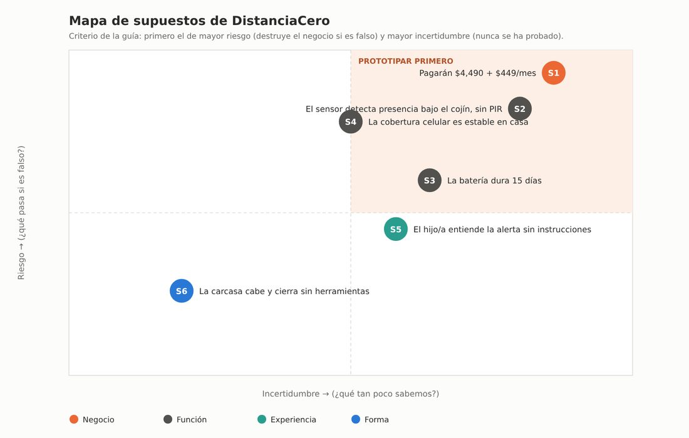<div style="display:none;border:2px dashed #888;border-radius:6px;padding:1.5rem .6rem;text-align:center;font-size:.85rem">📷 Espacio para imagen<br>Guárdala como <code>docs/recursos/imgs/mapa-supuestos.jpeg</code><br><em>Mapa de supuestos de DistanciaCero: riesgo contra incertidumbre</em></div></p>

*Figura 1. Mapa de supuestos. S1 (que alguien pague $4,490 + $449/mes) es el de mayor riesgo y mayor incertidumbre, y el único que puede probarse en un día con baja resolución.*


| Elemento del plan | Prototipo principal | Prototipo complementario |
|---|---|---|
| **Supuesto** | S1: un hijo/a adulto pagará $4,490 + $449/mes | S6: la carcasa cabe, cierra sin herramientas y se puede fabricar |
| **Pregunta precisa** | ¿Puede un hijo/a adulto explicar con sus palabras qué hace el producto y decidir si reserva, viendo el precio real, sin que nadie se lo justifique? | ¿Caben PCB, módulo celular y batería plana en una placa que cierre sin herramientas y que el hijo/a pueda abrir sin romperla? |
| **Tipo y resolución** | Negocio · baja | Forma · alta (digital) |
| **Qué se construyó** | Landing page estática con el precio real | Modelo 3D de dos variantes, planos con cotas y archivos STL |
| **Evidencia** | Sesión de 10 min con 3 a 5 personas del segmento; hoja de observación (4.2) | Apilado y holguras en el modelo; prueba de cierre y de 20 aperturas al imprimir |
| **Umbral de éxito** | 2 de 3 personas reservan y explican el producto en una frase | La tapa cierra con un solo movimiento y se abre con la uña; 20 ciclos sin fisura |
| **Estado** | Prototipo hecho; **sesiones pendientes** | Modelo hecho; **impresión y pruebas pendientes** |

<p style="text-align:center">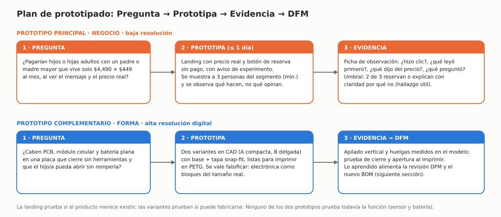<div style="display:none;border:2px dashed #888;border-radius:6px;padding:1.5rem .6rem;text-align:center;font-size:.85rem">📷 Espacio para imagen<br>Guárdala como <code>docs/recursos/imgs/plan-prototipado.jpeg</code><br><em>Plan de prototipado con los tres pasos para el prototipo de negocio y el de forma</em></div></p>

*Figura 2. El plan de prototipado: dos ciclos Pregunta → Prototipa → Evidencia. El de forma alimenta la revisión DFM.*


### 4.2 Prototipo de negocio: la landing page

La página es de un solo archivo HTML, sin recursos externos. Muestra el precio real, declara que es un experimento, y su botón de reserva abre un mensaje que explica de qué trata la prueba. **No recopila datos ni envía nada**: sirve para observar a una persona mientras la usa, no para contar clics a distancia. Para una prueba a distancia habría que añadir un formulario o un contador, y eso sí implica recoger datos.

<p style="text-align:center">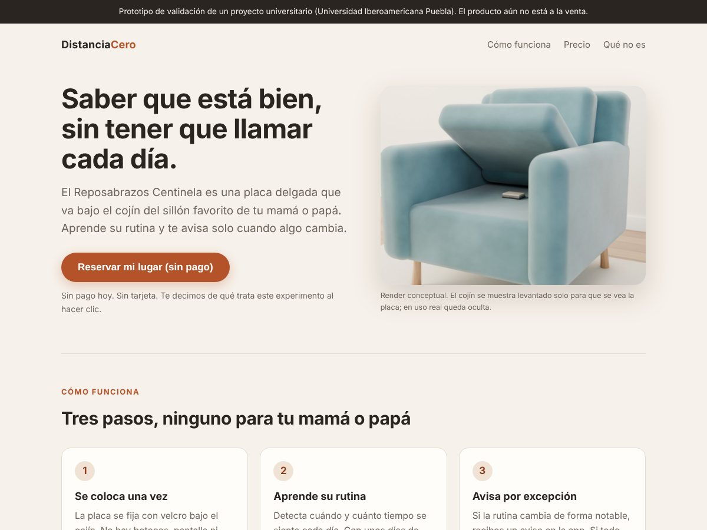<div style="display:none;border:2px dashed #888;border-radius:6px;padding:1.5rem .6rem;text-align:center;font-size:.85rem">📷 Espacio para imagen<br>Guárdala como <code>docs/recursos/imgs/landing-superior.jpeg</code><br><em>Parte superior de la landing page de DistanciaCero</em></div></p>

*Figura 3. Landing page, parte superior: aviso de experimento, mensaje central y botón de reserva sin pago.*


<p style="text-align:center">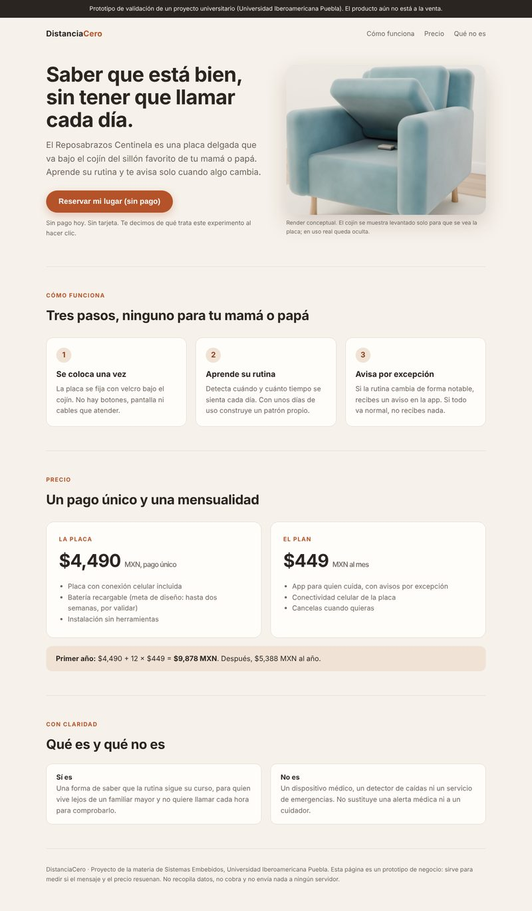<div style="display:none;border:2px dashed #888;border-radius:6px;padding:1.5rem .6rem;text-align:center;font-size:.85rem">📷 Espacio para imagen<br>Guárdala como <code>docs/recursos/imgs/landing-completa.jpeg</code><br><em>Landing page completa con pasos, precio y sección de lo que no es</em></div></p>

*Figura 4. Landing page completa: tres pasos, precio ($4,490 + $449/mes; primer año $9,878) y la sección "Qué es y qué no es".*


<p style="text-align:center">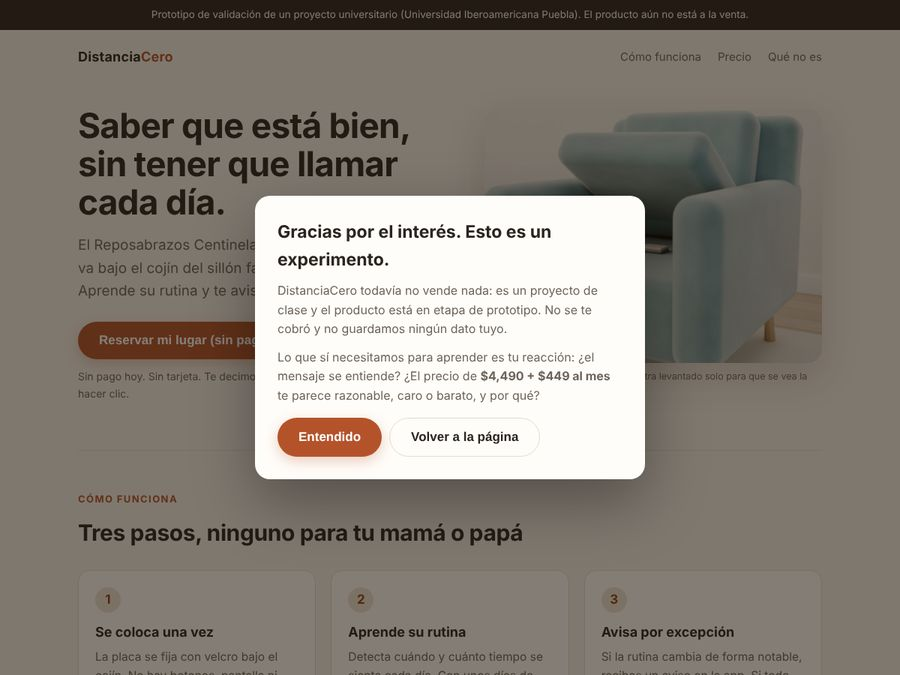<div style="display:none;border:2px dashed #888;border-radius:6px;padding:1.5rem .6rem;text-align:center;font-size:.85rem">📷 Espacio para imagen<br>Guárdala como <code>docs/recursos/imgs/landing-reservar.jpeg</code><br><em>Mensaje que se abre al pulsar reservar</em></div> 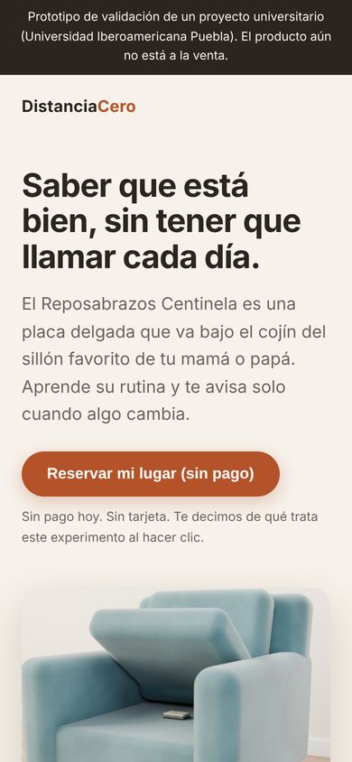<div style="display:none;border:2px dashed #888;border-radius:6px;padding:1.5rem .6rem;text-align:center;font-size:.85rem">📷 Espacio para imagen<br>Guárdala como <code>docs/recursos/imgs/landing-celular.jpeg</code><br><em>Landing page en pantalla de celular</em></div></p>

*Figura 5. A la izquierda, el mensaje que se abre al pulsar "Reservar mi lugar": explica que es un experimento, que no se cobró y qué queremos saber. A la derecha, la página en pantalla de celular.*

**Decisiones de diseño de la página que conviene defender:**

- **Honesta desde el primer vistazo.** El aviso permanente y el mensaje del botón evitan engañar a quien participa. El objetivo es medir la reacción al precio, no recolectar correos con una promesa falsa.
- **La batería aparece como meta, no como hecho** ("meta de diseño: hasta dos semanas, por validar"), porque con la batería plana la cuenta da ≈ 11.4 días.
- **Dice qué no es.** "No es un dispositivo médico, un detector de caídas ni un servicio de emergencias." Reduce la confusión que se vigila en la sesión.

??? example "Código completo de la landing (clic para desplegar; la imagen incrustada se omite)"
    ```html
    <!doctype html>
    <html lang="es"><head><meta charset="utf-8"><meta name="viewport" content="width=device-width,initial-scale=1">
    <title>DistanciaCero · Reposabrazos Centinela</title>
    <style>
    :root{--bg:#f6f1ea;--ink:#2a2521;--mut:#6d645b;--card:#fffdf9;--line:#e4dccf;--acc:#b4532a;--acc2:#8f3f1d;--taupe:#8b7d70}
    *{box-sizing:border-box}html{scroll-behavior:smooth}
    body{margin:0;background:var(--bg);color:var(--ink);font:17px/1.6 "Segoe UI",system-ui,-apple-system,"Helvetica Neue",Arial,sans-serif}
    .wrap{max-width:1040px;margin:0 auto;padding:0 24px}
    header{display:flex;justify-content:space-between;align-items:center;padding:22px 0}
    .logo{font-weight:700;letter-spacing:.2px;font-size:18px}.logo span{color:var(--acc)}
    nav a{color:var(--mut);text-decoration:none;margin-left:22px;font-size:15px}
    .hero{display:grid;grid-template-columns:1.05fr .95fr;gap:44px;align-items:center;padding:30px 0 64px}
    h1{font-size:46px;line-height:1.1;margin:0 0 18px;letter-spacing:-.8px}
    .lead{font-size:19px;color:var(--mut);margin:0 0 26px}
    .btn{display:inline-block;background:var(--acc);color:#fff;border:0;border-radius:999px;padding:15px 28px;font-size:17px;font-weight:600;cursor:pointer;box-shadow:0 6px 18px rgba(180,83,42,.28)}
    .btn:hover{background:var(--acc2)}.sub{display:block;margin-top:12px;color:var(--mut);font-size:14px}
    .photo{border-radius:20px;overflow:hidden;box-shadow:0 18px 50px rgba(60,40,20,.18);background:#ddd}
    .photo img{display:block;width:100%}
    .cap{font-size:12.5px;color:var(--mut);margin-top:8px}
    section{padding:54px 0;border-top:1px solid var(--line)}
    h2{font-size:30px;margin:0 0 8px;letter-spacing:-.4px}.k{color:var(--acc);font-weight:700;font-size:13px;letter-spacing:1.4px;text-transform:uppercase;margin-bottom:10px}
    .steps{display:grid;grid-template-columns:repeat(3,1fr);gap:20px;margin-top:26px}
    .step{background:var(--card);border:1px solid var(--line);border-radius:16px;padding:22px}
    .step b{display:inline-grid;place-items:center;width:34px;height:34px;border-radius:50%;background:#f0e3d6;color:var(--acc2);margin-bottom:12px}
    .step h3{margin:0 0 6px;font-size:18px}.step p{margin:0;color:var(--mut);font-size:15.5px}
    .price{display:grid;grid-template-columns:1fr 1fr;gap:20px;margin-top:26px}
    .pc{background:var(--card);border:1px solid var(--line);border-radius:18px;padding:28px}
    .pc .n{font-size:40px;font-weight:700;letter-spacing:-1px}.pc .n small{font-size:16px;font-weight:500;color:var(--mut)}
    .pc ul{margin:14px 0 0;padding-left:20px;color:var(--mut);font-size:15.5px}
    .total{margin-top:18px;background:#f0e3d6;border-radius:14px;padding:16px 22px;font-size:16px}
    .not{display:grid;grid-template-columns:1fr 1fr;gap:20px;margin-top:20px}
    .not div{background:var(--card);border:1px solid var(--line);border-radius:14px;padding:18px 22px;font-size:15.5px;color:var(--mut)}
    .not b{color:var(--ink)}
    footer{padding:36px 0 60px;color:var(--mut);font-size:13.5px;border-top:1px solid var(--line)}
    .banner{background:#2a2521;color:#f6f1ea;font-size:13.5px;text-align:center;padding:9px 16px}
    dialog{border:0;border-radius:20px;max-width:520px;width:calc(100% - 32px);padding:30px;box-shadow:0 30px 80px rgba(0,0,0,.35);background:var(--card);color:var(--ink)}
    dialog::backdrop{background:rgba(30,20,10,.55)}
    dialog h3{margin:0 0 10px;font-size:23px}dialog p{margin:0 0 12px;color:var(--mut);font-size:16px}
    dialog .row{display:flex;gap:10px;margin-top:16px;flex-wrap:wrap}
    .ghost{background:transparent;color:var(--ink);border:1px solid var(--line);box-shadow:none}.ghost:hover{background:#f6f1ea}
    @media(max-width:820px){.hero,.steps,.price,.not{grid-template-columns:1fr}h1{font-size:36px}nav{display:none}}
    </style></head><body>
    <div class="banner">Prototipo de validación de un proyecto universitario (Universidad Iberoamericana Puebla). El producto aún no está a la venta.</div>
    <div class="wrap">
    <header><div class="logo">Distancia<span>Cero</span></div><nav><a href="#como">Cómo funciona</a><a href="#precio">Precio</a><a href="#limites">Qué no es</a></nav></header>

    <div class="hero">
     <div>
      <h1>Saber que está bien, sin tener que llamar cada día.</h1>
      <p class="lead">El Reposabrazos Centinela es una placa delgada que va bajo el cojín del sillón favorito de tu mamá o papá. Aprende su rutina y te avisa solo cuando algo cambia.</p>
      <button class="btn" id="reservar">Reservar mi lugar (sin pago)</button>
      <span class="sub">Sin pago hoy. Sin tarjeta. Te decimos de qué trata este experimento al hacer clic.</span>
     </div>
     <div><div class="photo"><div style="display:none;border:2px dashed #888;border-radius:6px;padding:1.5rem .6rem;text-align:center;font-size:.85rem">📷 Espacio para imagen<br>Guárdala como <code>docs/recursos/imgs/render-placa-sillon.jpeg</code><br><em>Render conceptual de la placa Reposabrazos Centinela sobre la base de un sillón, con el cojín levantado</em></div></div>
     <div class="cap">Render conceptual. El cojín se muestra levantado solo para que se vea la placa; en uso real queda oculta.</div></div>
    </div>

    <section id="como"><div class="k">Cómo funciona</div><h2>Tres pasos, ninguno para tu mamá o papá</h2>
     <div class="steps">
      <div class="step"><b>1</b><h3>Se coloca una vez</h3><p>La placa se fija con velcro bajo el cojín. No hay botones, pantalla ni cables que atender.</p></div>
      <div class="step"><b>2</b><h3>Aprende su rutina</h3><p>Detecta cuándo y cuánto tiempo se sienta cada día. Con unos días de uso construye un patrón propio.</p></div>
      <div class="step"><b>3</b><h3>Avisa por excepción</h3><p>Si la rutina cambia de forma notable, recibes un aviso en la app. Si todo va normal, no recibes nada.</p></div>
     </div></section>

    <section id="precio"><div class="k">Precio</div><h2>Un pago único y una mensualidad</h2>
     <div class="price">
      <div class="pc"><div class="k" style="margin:0 0 6px">La placa</div><div class="n">$4,490 <small>MXN, pago único</small></div>
       <ul><li>Placa con conexión celular incluida</li><li>Batería recargable (meta de diseño: hasta dos semanas, por validar)</li><li>Instalación sin herramientas</li></ul></div>
      <div class="pc"><div class="k" style="margin:0 0 6px">El plan</div><div class="n">$449 <small>MXN al mes</small></div>
       <ul><li>App para quien cuida, con avisos por excepción</li><li>Conectividad celular de la placa</li><li>Cancelas cuando quieras</li></ul></div>
     </div>
     <div class="total"><b>Primer año:</b> $4,490 + 12 × $449 = <b>$9,878 MXN</b>. Después, $5,388 MXN al año.</div>
    </section>

    <section id="limites"><div class="k">Con claridad</div><h2>Qué es y qué no es</h2>
     <div class="not">
      <div><b>Sí es</b><br>Una forma de saber que la rutina sigue su curso, para quien vive lejos de un familiar mayor y no quiere llamar cada hora para comprobarlo.</div>
      <div><b>No es</b><br>Un dispositivo médico, un detector de caídas ni un servicio de emergencias. No sustituye una alerta médica ni a un cuidador.</div>
     </div></section>

    <footer>DistanciaCero · Proyecto de la materia de Sistemas Embebidos, Universidad Iberoamericana Puebla. Esta página es un prototipo de negocio: sirve para medir si el mensaje y el precio resuenan. No recopila datos, no cobra y no envía nada a ningún servidor.</footer>
    </div>

    <dialog id="dlg"><h3>Gracias por el interés. Esto es un experimento.</h3>
     <p>DistanciaCero todavía no vende nada: es un proyecto de clase y el producto está en etapa de prototipo. No se te cobró y no guardamos ningún dato tuyo.</p>
     <p>Lo que sí necesitamos para aprender es tu reacción: ¿el mensaje se entiende? ¿El precio de <b>$4,490 + $449 al mes</b> te parece razonable, caro o barato, y por qué?</p>
     <div class="row"><button class="btn" id="cerrar">Entendido</button><button class="btn ghost" id="cerrar2">Volver a la página</button></div>
    </dialog>
    <script>
    var d=document.getElementById('dlg');
    document.getElementById('reservar').addEventListener('click',function(){d.showModal()});
    ['cerrar','cerrar2'].forEach(function(i){document.getElementById(i).addEventListener('click',function(){d.close()})});
    </script>
    </body></html>
    ```

**Protocolo de la sesión (10 minutos por persona)**

1. Mostrar la página en una pantalla sin explicar nada. Pedir: "Dime en voz alta qué estás viendo y qué harías".
2. Observar sin intervenir: qué lee primero, cuánto tarda en llegar al precio, si hace clic.
3. Si se atora, una sola pregunta: "¿qué esperabas que pasara?".
4. Al terminar: "¿Qué precio te parecería razonable?". Después: "¿Y si el hardware costara $3,990?".
5. Registrar en la hoja de abajo, con las palabras textuales de la persona.

**Hoja de observación (a llenar en las sesiones)**

| Usuario | Perfil | Tiempo hasta el 1.er clic | Qué leyó primero | ¿Encontró el precio? | ¿Reservó? | Qué dijo del precio (textual) | Qué preguntó | Precio que propuso |
|---|---|---|---|---|---|---|---|---|
| 1 | *pendiente* | | | | | | | |
| 2 | *pendiente* | | | | | | | |
| 3 | *pendiente* | | | | | | | |

!!! warning "Evidencia pendiente"
    No hice las sesiones con usuarios. La hoja está vacía a propósito: no inventé observaciones. Sin ellas, el supuesto S1 sigue **sin validar** y el DVF de deseabilidad sigue en 🔴.

### 4.3 Prototipo de forma: carcasa en dos variantes

Modelé la carcasa en Blender con las medidas de los componentes reales (Prompt 3) y la dibujé en dos variantes para poder compararlas con usuarios. Las dos son de **dos piezas, un solo material (PETG) y cierre a presión**, sin tornillos.

<p style="text-align:center">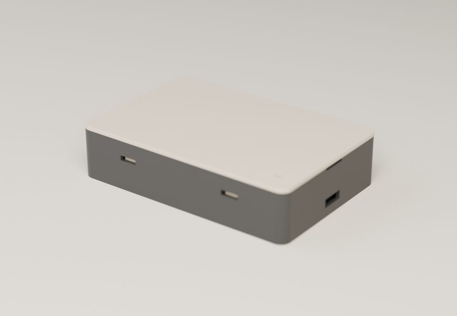<div style="display:none;border:2px dashed #888;border-radius:6px;padding:1.5rem .6rem;text-align:center;font-size:.85rem">📷 Espacio para imagen<br>Guárdala como <code>docs/recursos/imgs/variante-a-cerrada.jpeg</code><br><em>Variante A cerrada</em></div></p>

*Figura 6. Variante A "compacta", 90 × 60 × 21 mm. Base oscura y tapa clara; se ven las ventanas de los ganchos y la abertura USB-C. Render del modelo 3D, no foto de una pieza impresa.*


<p style="text-align:center">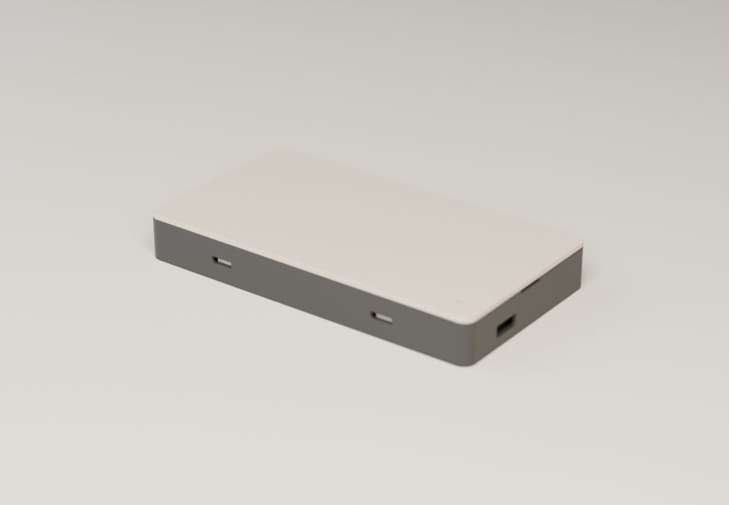<div style="display:none;border:2px dashed #888;border-radius:6px;padding:1.5rem .6rem;text-align:center;font-size:.85rem">📷 Espacio para imagen<br>Guárdala como <code>docs/recursos/imgs/variante-b-cerrada.jpeg</code><br><em>Variante B cerrada</em></div></p>

*Figura 7. Variante B "delgada", 114 × 62 × 15 mm.*


<p style="text-align:center">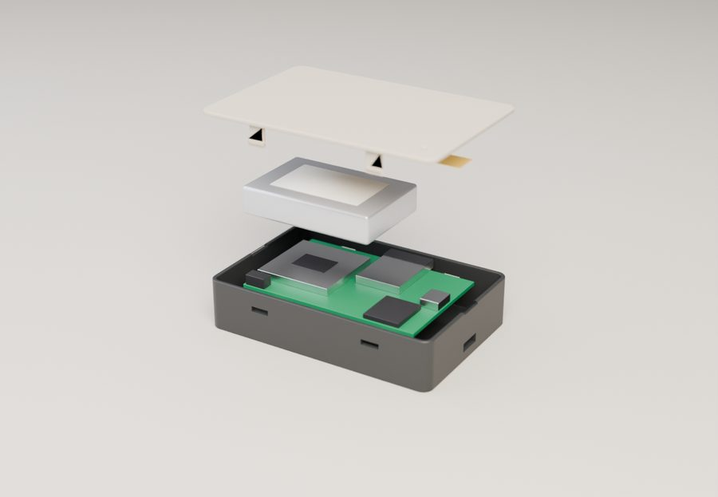<div style="display:none;border:2px dashed #888;border-radius:6px;padding:1.5rem .6rem;text-align:center;font-size:.85rem">📷 Espacio para imagen<br>Guárdala como <code>docs/recursos/imgs/variante-a-explosionada.jpeg</code><br><em>Variante A en vista explosionada</em></div></p>

*Figura 8. Variante A explosionada, de abajo hacia arriba: base con el PCB sobre costillas, batería LiPo plana encima, y tapa con la antena celular en su cara interior. Los componentes son bloques del tamaño real, no modelos detallados.*


<p style="text-align:center">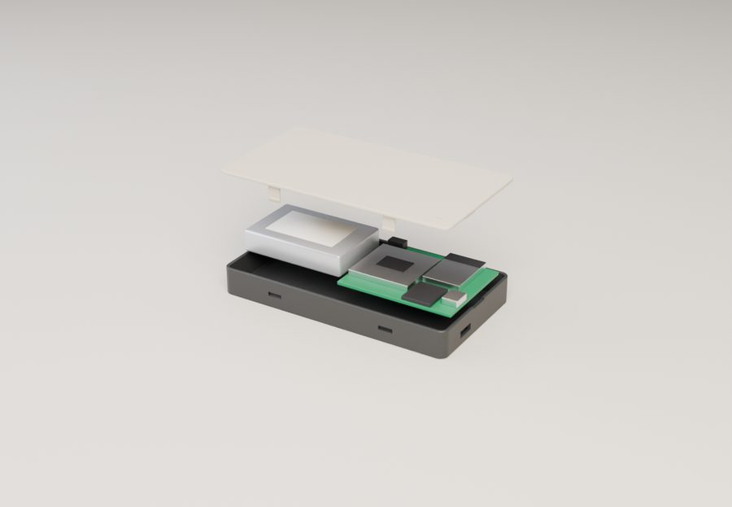<div style="display:none;border:2px dashed #888;border-radius:6px;padding:1.5rem .6rem;text-align:center;font-size:.85rem">📷 Espacio para imagen<br>Guárdala como <code>docs/recursos/imgs/variante-b-explosionada.jpeg</code><br><em>Variante B en vista explosionada</em></div></p>

*Figura 9. Variante B explosionada: la batería va al lado del PCB, por eso el grosor baja a 15 mm.*


<p style="text-align:center">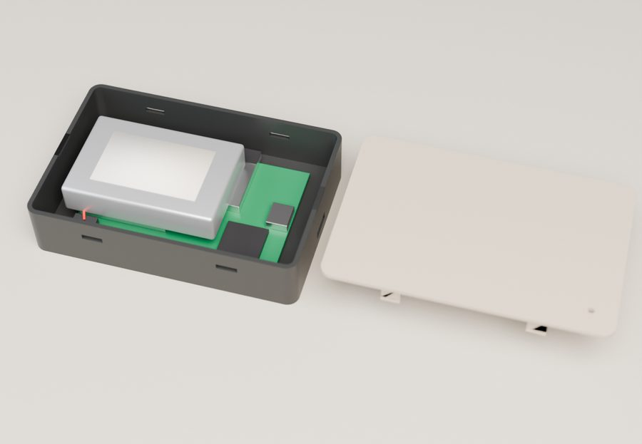<div style="display:none;border:2px dashed #888;border-radius:6px;padding:1.5rem .6rem;text-align:center;font-size:.85rem">📷 Espacio para imagen<br>Guárdala como <code>docs/recursos/imgs/variante-a-abierta.jpeg</code><br><em>Variante A abierta</em></div></p>

*Figura 10. Variante A con la tapa retirada: la batería cubre parte del PCB; el módulo celular queda debajo.*


<p style="text-align:center">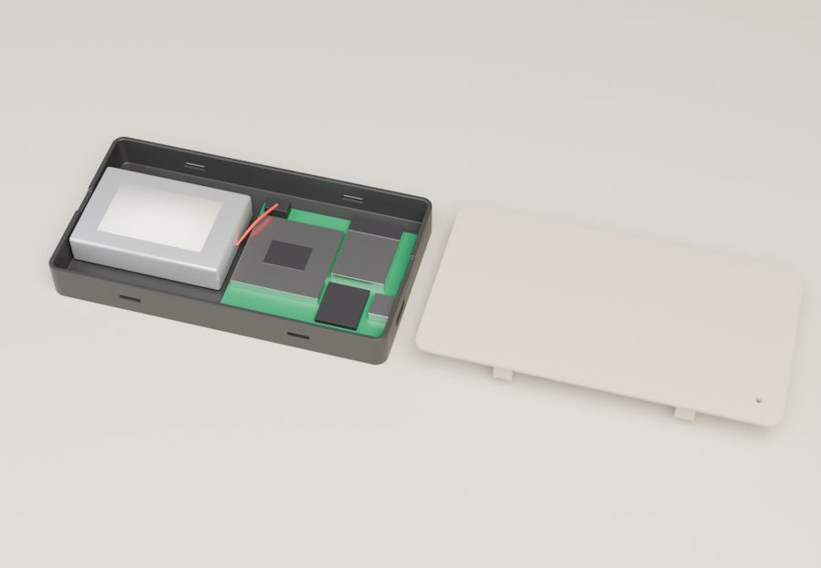<div style="display:none;border:2px dashed #888;border-radius:6px;padding:1.5rem .6rem;text-align:center;font-size:.85rem">📷 Espacio para imagen<br>Guárdala como <code>docs/recursos/imgs/variante-b-abierta.jpeg</code><br><em>Variante B abierta</em></div></p>

*Figura 11. Variante B con la tapa retirada: batería (izquierda) y PCB con ESP32-S3, módulo celular, USB-C y portatarjeta SIM (derecha). El cable rojo es la batería hacia el conector JST.*


**Planos con cotas.** Cada plano muestra la vista superior, el corte longitudinal A-A, el corte B-B por los ganchos y el detalle del cierre a escala 4:1.

<p style="text-align:center">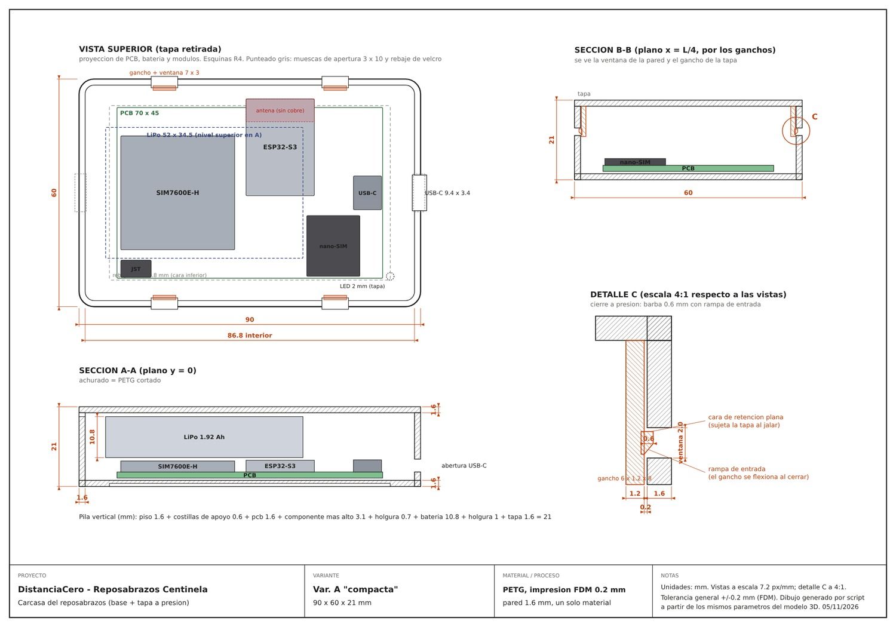<div style="display:none;border:2px dashed #888;border-radius:6px;padding:1.5rem .6rem;text-align:center;font-size:.85rem">📷 Espacio para imagen<br>Guárdala como <code>docs/recursos/imgs/plano-variante-a.jpeg</code><br><em>Plano técnico de la variante A</em></div></p>

*Figura 12. Plano de la variante A "compacta".*


<p style="text-align:center">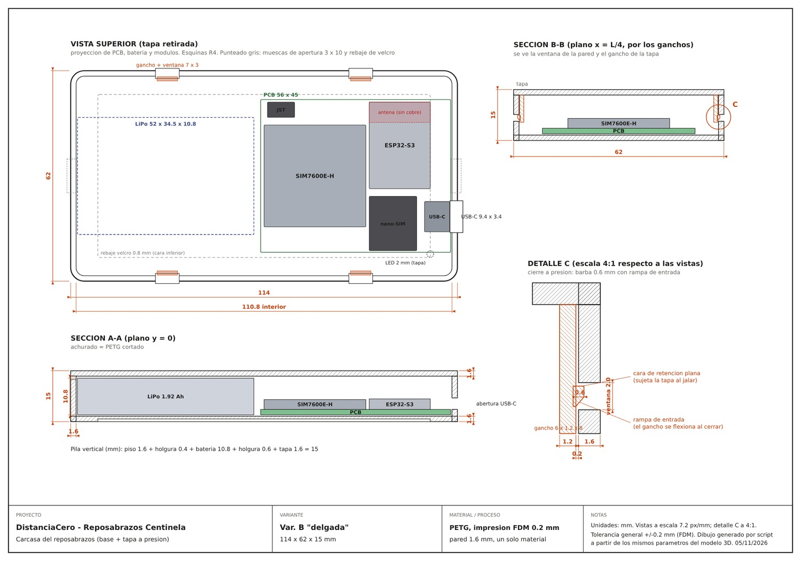<div style="display:none;border:2px dashed #888;border-radius:6px;padding:1.5rem .6rem;text-align:center;font-size:.85rem">📷 Espacio para imagen<br>Guárdala como <code>docs/recursos/imgs/plano-variante-b.jpeg</code><br><em>Plano técnico de la variante B</em></div></p>

*Figura 13. Plano de la variante B "delgada".*


**Comparación de las dos variantes**

| | **A "compacta"** | **B "delgada"** |
|---|---|---|
| Exterior (L × W × H) | 90 × 60 × 21 mm | 114 × 62 × 15 mm |
| Disposición | batería sobre el PCB | batería al lado del PCB |
| PCB | 70 × 45 mm | 56 × 45 mm |
| Holgura más justa | 0.7 mm (ESP32 contra batería) | 0.4 mm (pared contra batería y contra PCB) |
| Volumen de plástico (base + tapa) | 22.7 cm³ | 25.3 cm³ |
| Masa estimada en PETG ⚠️ | ≈ 29 g | ≈ 32 g |
| Pregunta que responde con usuarios | ¿Se nota el grosor de 21 mm bajo el cojín? | ¿Molesta una placa más larga y delgada? |

*La masa se calculó con una densidad de 1.27 g/cm³ (valor típico del PETG, no verificado para un filamento específico).*

**Archivos STL entregados** (orientados para imprimir; la tapa va boca abajo):

| Archivo | Volumen | Medidas | Aristas abiertas |
|---|--:|---|:--:|
| `A_base.stl` | 13,925 mm³ | 90.0 × 60.0 × 19.4 mm | 0 |
| `A_tapa.stl` | 8,817 mm³ | 90.0 × 60.0 × 9.6 mm | 0 |
| `B_base.stl` | 13,777 mm³ | 114.0 × 62.0 × 13.4 mm | 0 |
| `B_tapa.stl` | 11,477 mm³ | 114.0 × 62.0 × 9.6 mm | 0 |

**Revisión previa a imprimir.** Al ubicar los componentes encontré un error mío: en la primera disposición el USB-C quedaba encima del módulo ESP32 y el portatarjeta sobre el mismo módulo. Reacomodé los componentes (la disposición final está en los planos) y verifiqué que ningún par de piezas se traslape en planta. Ese tipo de choque es justo lo que el prototipo de forma debe encontrar antes de gastar filamento. Después hice una segunda verificación automática, ahora en 3D, de las cajas de todas las piezas contra la batería, el PCB y las paredes: en la variante B no encontró choques, y en la A el conector JST de la batería se traslapaba 0.2 mm con la batería, así que lo moví 1 mm. Es una verificación de cajas envolventes, no de las formas reales.

!!! warning "Lo que este prototipo todavía no demuestra"
    Es un modelo digital. No imprimí ninguna pieza, no probé el cierre ni los 20 ciclos de apertura, y las cotas de los componentes marcadas con ⚠️ (módulo celular, USB-C, portatarjeta, antena) deben confirmarse con las fichas de las piezas elegidas. Que las mallas estén cerradas no garantiza que el laminador las imprima sin problemas.

### 4.4 Revisión DFM

La revisión completa, en el formato de la clase, está en el Prompt 2. Resumen del costo unitario a 10 unidades (MXN, tipo de cambio implícito del modelo):

| Concepto | Actual | Con mejoras DFM | Diferencia |
|---|--:|--:|--:|
| BOM electrónico | $2,520 | $1,160 | −$1,360 |
| PCB + PCBA | $250 | $250 | $0 |
| Carcasa | $200 | $70 | −$130 |
| Ensamble manual ⚠️ | $66 (33 min) | $18 (9 min) | −$48 |
| Gastos indirectos (15 %) | $455 | $225 | −$230 |
| **Costo unitario** | **$3,491** | **$1,723** | **−$1,769 (−50.7 %)** |

<p style="text-align:center">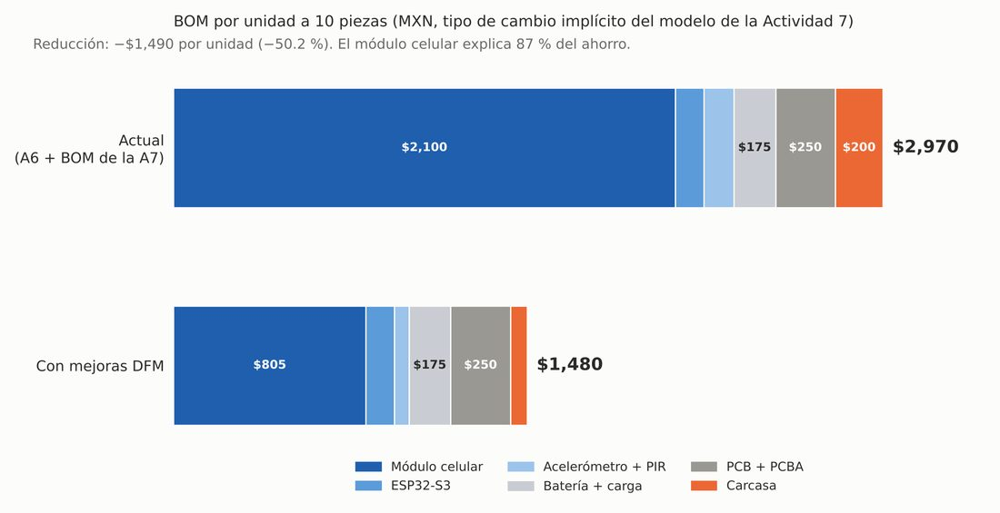<div style="display:none;border:2px dashed #888;border-radius:6px;padding:1.5rem .6rem;text-align:center;font-size:.85rem">📷 Espacio para imagen<br>Guárdala como <code>docs/recursos/imgs/bom-antes-despues.jpeg</code><br><em>BOM por unidad antes y después del DFM</em></div></p>

*Figura 14. BOM por unidad: de $2,970 a $1,480. El módulo celular explica el 87 % del ahorro; la carcasa y el sensor, el resto.*


<p style="text-align:center">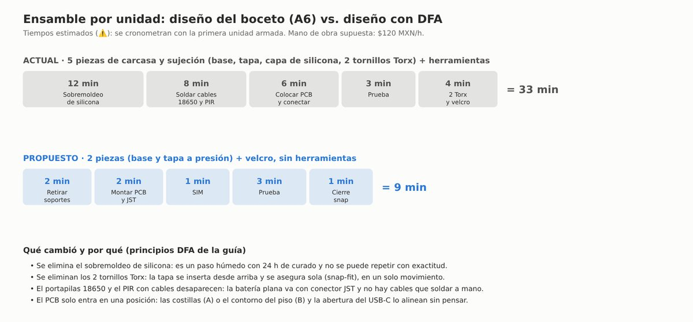<div style="display:none;border:2px dashed #888;border-radius:6px;padding:1.5rem .6rem;text-align:center;font-size:.85rem">📷 Espacio para imagen<br>Guárdala como <code>docs/recursos/imgs/ensamble-antes-despues.jpeg</code><br><em>Ensamble por unidad antes y después del DFA</em></div></p>

*Figura 15. Ensamble por unidad: 5 piezas y ~33 minutos contra 2 piezas y ~9 minutos (⚠️ estimados; se cronometran con la primera unidad armada).*


**Los cinco pasos del proceso en una tabla**

| Paso | Hallazgo | Acción |
|---|---|---|
| 1. Estimar | El costo unitario real con ensamble e indirectos es $3,491, no solo el BOM | Usar este desglose como línea base |
| 2. Reducir componentes | El módulo celular es 71 % del BOM y se compra montado | Usar el chip LCC en el PCB propio (−$1,295) |
| 3. Disminuir ensamble | 5 piezas, herramienta y un paso húmedo de 24 h | 2 piezas a presión, sin herramientas (de ~33 a ~9 min) |
| 4. Reducir soporte | ~12 referencias, soldadura de cables y colada de silicona | 7 referencias; solo 5 uniones manuales; prueba funcional por USB-C |
| 5. Otros factores | Cada ahorro tiene un costo | Ver trade-offs abajo |

**Trade-offs que hay que decidir, no ignorar**

| Mejora | Qué se gana | Qué se arriesga |
|---|---|---|
| Módulo celular en chip LCC | −$1,295 por unidad | Ciclo de RF y homologación fuera del presupuesto de la semana 7; solo 6 piezas en existencia. Aguanta hasta ≈ $187,000 extra antes de perder frente al diseño actual |
| Batería LiPo plana | Cabe en 10.8 mm | Autonomía ≈ 11.4 días contra los 15 del requisito RD-01 (máximo 5.33 mA promedio para cumplirlo) |
| Sin silicona, con tela adhesiva | −12 min de mano de obra y −24 h de curado | Se pierde parte del tacto suave que definía el concepto |
| Sin sensor PIR | −$65 y cabe en 15 mm | Si el acelerómetro solo no distingue "se sentó", no hay detección |
| Ganchos de PETG | Sin tornillos ni herramientas | Resistencia a la fatiga en la dirección débil de FDM; probar 20 ciclos |

**Compatibilidad con JLCPCB PCBA: ⚠️**

| Componente | Estado | Qué hacer |
|---|:--:|---|
| ESP32-S3-WROOM-1-N8R8 | ✅ | Módulo con pads de 1.27 mm, 9,101 en existencia en LCSC; asumo pieza Extended (US$3.07 por pedido) |
| SIM7600E-H LCC | ⚠️ | Confirmar que JLCPCB lo ensambla y cotizar 10 piezas (hoy hay 6) |
| USB-C, portatarjeta SIM, JST | ⚠️ | Elegir piezas con existencias en la librería; asumo Extended |
| MPU6050 | ✅ | Módulo GY-521 soldado a mano (pitch 2.54 mm), no QFN de 0.5 mm |
| PCB | ✅ | 2 capas, un solo lado SMT, sin BGA ni pitch < 0.5 mm |

### 4.5 Efecto del DFM sobre el modelo financiero de la semana 7

<p style="text-align:center">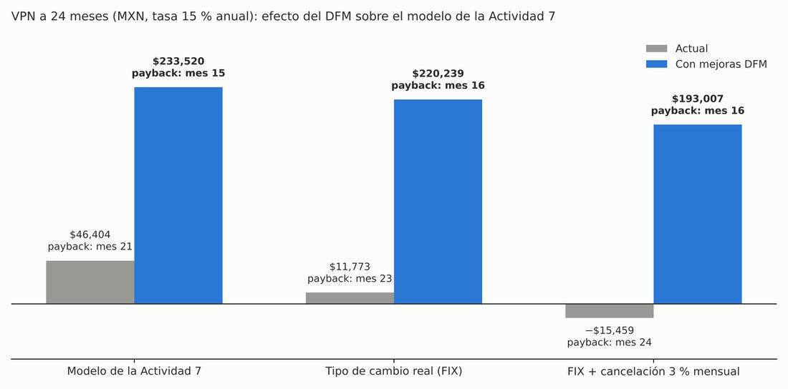<div style="display:none;border:2px dashed #888;border-radius:6px;padding:1.5rem .6rem;text-align:center;font-size:.85rem">📷 Espacio para imagen<br>Guárdala como <code>docs/recursos/imgs/vpn-antes-despues.jpeg</code><br><em>VPN a 24 meses antes y después del DFM en tres escenarios</em></div></p>

*Figura 16. VPN a 24 meses y mes de recuperación (payback) en tres escenarios. El diseño con DFM cierra en los tres, incluido el que dejaba al diseño actual en negativo.*


| Escenario | Actual: VPN 24 m / recuperación | Con DFM: VPN 24 m / recuperación |
|---|---|---|
| Modelo de la semana 7 | +$46,404 / mes 21 | **+$233,520 / mes 15** |
| Tipo de cambio real (FIX) | +$11,773 / mes 23 | **+$220,239 / mes 16** |
| FIX + 3 % de cancelación mensual | −$15,459 / mes 24 | **+$193,007 / mes 16** |

El costo unitario del modelo baja de $4,158 a $2,072 (BOM × 1.40), el margen del hardware a $4,490 pasa de ≈ 7 % a ≈ 54 %, y el precio mínimo viable de la regla del curso (BOM ÷ 30 %) baja de $9,900 a $4,933. **Tres advertencias:** el VPN a 12 meses sigue negativo (−$49,120), el ahorro depende de un precio "desde" con 6 piezas en existencia, y el umbral de ≈ $187,000 de desarrollo adicional que aguanta el cambio no incluye todavía ninguna estimación real del trabajo de radio.

### 4.6 Circularidad (Ley General de Economía Circular)

La revisión completa está en el Prompt 4. Resumen contra las cuatro preguntas de la clase:

| Pregunta | ¿Cumple hoy? | Qué lo hace cumplir |
|---|:--:|---|
| ¿Componentes accesibles sin destruir la carcasa? | ✅ | Snap-fit sin pegamento ni tornillos; muescas para abrir con la uña |
| ¿Módulos reemplazables por separado? | ⚠️ parcial | Batería por conector JST; acelerómetro en header hembra; ESP32 y módulo celular soldados |
| ¿Materiales identificables? | ⚠️ | Un solo plástico (PETG) con marcado en relieve; confirmar el código de reciclaje; separar tela y velcro |
| ¿Se actualiza sin reemplazarse? | ✅ ⚠️ | Firmware por USB-C; la actualización remota exige reservar una partición de flash |

**Estado de la ley:** vigente desde el 20/01/2026; la REP aplica por sector cuando SEMARNAT publique acuerdos; al 30/08/2026 el reglamento no estaba publicado y la nota consultada no mencionaba electrónicos. No hay hoy una obligación sectorial específica que pueda citar para este producto.

### 4.7 BOM actualizado (tarea en casa)

| Línea | Antes (semana 7) | Ahora | Estado del dato |
|---|--:|--:|---|
| Módulo celular | $2,100 (SIM7600E-H montado, US$129) | **$805** (SIM7600E-H LCC) | ⚠️ Precio "desde" US$49.47 en LCSC (05/11/2026), 6 en existencia, sin precio por tramo; convertido a la tasa implícita del modelo. Al FIX serían $911 |
| ESP32-S3 | $120 | $120 | ⚠️ Estimado. LCSC N8R8 "desde" US$3.48 (≈ $64 al FIX): sin ahorro asumido |
| Acelerómetro + PIR | $125 | **$60** (GY-521, sin PIR) | ⚠️ Estimado |
| Batería + carga | $175 | $175 | ⚠️ Estimado; no vi el precio de la Jauch |
| PCB + PCBA | $250 | $250 | ⚠️ Estimado; la estructura de cuotas sí está verificada |
| Carcasa | $200 | **$70** | ⚠️ Estimado (PETG $14 + impresora $38 + velcro $8 + tela $10) |
| **BOM por unidad** | **$2,970** | **$1,480** | Solo la línea del módulo celular tiene una fuente directa |
| Costo unitario del modelo (× 1.40) | $4,158 | $2,072 | |

### 4.8 Estado de la tarea en casa

| Tarea | Estado |
|---|---|
| Construir el primer prototipo según el plan | ✅ Landing y modelo 3D listos · ⏳ **Pendiente imprimir** la carcasa (archivos STL listos) |
| Probar con mínimo 3 usuarios del segmento | ⏳ **Pendiente.** Hoja de observación y protocolo listos; sin observaciones |
| Aplicar mejoras DFM y actualizar el BOM | ✅ BOM y costo unitario nuevos (4.7), con las estimaciones marcadas |

### 4.9 Defensa del plan (4 minutos)

**Minuto 1: el supuesto más riesgoso.** "El supuesto que necesitamos validar primero es que un hijo o hija adulto pagará $4,490 de hardware más $449 al mes. Si resulta falso, el VPN de +$46,404 que calculamos en la semana 7 no se sostiene, porque no habría ventas. Además, ese precio está por encima del rango que el mercado toleró en la semana 4."

**Minuto 2: el prototipo.** "Construimos una landing page, de baja resolución, con el precio real y un botón de reserva sin pago. La pregunta que responde es: ¿puede un hijo o hija adulto explicar qué hace el producto y decidir si reserva, sin que le justifiquemos el precio? En paralelo modelamos dos variantes de carcasa para ver si el producto cabe."

**Minuto 3: la evidencia.** "Sabremos que funcionó cuando 2 de 3 personas del segmento, idealmente 3 de 5, hagan clic en reservar y expliquen el producto en una frase. Hoy tenemos la página y el protocolo; **todavía no tenemos las sesiones**."

**Minuto 4: DFM, el cambio más importante.** "La revisión DFM nos dice que el componente de mayor costo es el módulo celular SIM7600E-H, $2,100, el 71 % del BOM. Si lo reemplazamos por el mismo chip en formato LCC sobre nuestro propio PCB, y aplicamos los cambios de carcasa y sensor, el costo unitario baja de $3,491 a $1,723 MXN. La condición es que ese ahorro exige diseñar la sección de radio, que no está en nuestro presupuesto."

**Preguntas probables del instructor y mi respuesta**

| Pregunta | Respuesta |
|---|---|
| ¿Por qué ese supuesto y no otro más fundamental del negocio? | S2 (que el sensor detecte sentarse) es igual de fundamental, pero exige hardware y varios días. Si nadie paga el precio, S2 no importa; si el sensor falla, S1 tampoco. S1 se responde en un día y S2 es el siguiente ciclo |
| Si el usuario no puede hacer la acción, ¿qué cambian: el diseño, el material o la instalación? | Si no explica el producto, cambio el mensaje de la página. Si no pagaría, reviso el precio con las sensibilidades de la semana 7. Si la tapa no abre o se rompe, cambio la geometría del gancho o la orientación de impresión, antes de cambiar de material |
| ¿El prototipo es de baja resolución porque la pregunta lo permite o porque no hay tiempo? | El de negocio, porque la pregunta lo permite: trata de mensaje y precio. El de forma es de alta resolución digital porque necesita medidas exactas; lo que me falta es imprimirlo |
---

## 5. Veredicto de la semana

**QUEDA RESUELTO:** plan de prototipado con seis supuestos clasificados y el más riesgoso identificado (S1, el precio) · prototipo de negocio (landing con el precio real, protocolo de sesión y hoja de observación) · prototipo de forma en dos variantes, con modelo 3D, planos con cotas y cuatro archivos STL con malla cerrada · revisión DFM en el formato de cinco pasos de la clase · efecto del DFM sobre el modelo de la semana 7 con sensibilidades · revisión de circularidad frente a la Ley General de Economía Circular · BOM y costo unitario actualizados · guion de defensa de 4 minutos.

| Dimensión | Estado | Por qué |
|---|:--:|---|
| Deseable | 🔴 | Ninguna persona del segmento ha visto la landing todavía. El hardware de $4,490 sigue por encima del rango que toleró el mercado en la semana 4 |
| Factible | 🟡 | La carcasa cabe en el modelo, en dos variantes, y es imprimible en PETG sin soportes. No imprimí nada; la autonomía de 15 días no se cumple con la batería elegida (11.4 días con 7 mA promedio) |
| Viable | 🟡 | Con el DFM completo el modelo da VPN a 24 meses de $233,520 (antes $46,404) y recuperación en el mes 15. Depende de dos cosas que no he verificado: el ahorro del módulo celular LCC (precio "desde", existencias de 6 piezas) y un costo de desarrollo de radio y homologación que el presupuesto de $71,540 no incluye (el modelo lo tolera hasta ≈ $187,000) |
| Dato más débil | 🔴 | Cero sesiones con usuarios; ningún tiempo de ensamble medido; precio de la batería y espesor del módulo celular sin confirmar |

**QUEDA PENDIENTE:**

1. **Hacer las sesiones con 3 a 5 personas del segmento** y llenar la hoja de observación. Es lo que le da sentido a la landing; hoy solo existe el instrumento.
2. **Imprimir las dos variantes** y probar el cierre, 20 aperturas, el ajuste de la batería y el cabeceo bajo el cojín.
3. **Cotizar el módulo celular en formato LCC para 10 piezas** y confirmar su espesor, y cotizar el resto del BOM con proveedor (hoy son estimaciones ⚠️).
4. **Decidir qué hacer con la autonomía:** una batería más grande en la variante B, un consumo promedio menor o relajar el requisito de 15 días.
5. **Presupuestar el diseño de radio y la homologación** o decidir que la primera tanda use el módulo ya certificado.
6. **Resolver el precio:** la landing usa $4,490 + $449/mes, el prototipo de Figma de la semana 6 mostraba $249/mes, y el rango tolerado en la semana 4 era menor.

---

## 6. ¿Qué aprendí?

Lo que más me quedó es que dibujar con medidas reales es una prueba de factibilidad más dura que cualquier revisión de ideas. El concepto de la semana 6 se veía razonable en el boceto y no se podía construir: la batería 18650 no cabía en 15 mm, el PIR medía el doble del grosor de la placa y el PCB con la batería no cabían lado a lado en 60 mm. Lo encontré al poner las cotas, no al discutirlo.

También entendí la regla del plan de prototipado: el prototipo es la pregunta más barata, y por eso el primero que hice no fue la carcasa, sino una página con el precio. El supuesto más riesgoso del proyecto es que alguien pague $4,490 más $449 al mes, y eso se puede probar en un día sin tocar hardware. La carcasa responde otra pregunta (¿cabe y se puede fabricar?), que es el siguiente ciclo.

El DFM me mostró que casi todo el ahorro está en un solo cambio. De los $1,490 que baja el BOM, el 87 % viene de cambiar el módulo celular por el mismo chip en formato LCC sobre mi propio PCB; el sensor, la carcasa y el ensamble suman poco. Pero ese ahorro tiene un costo escondido, el diseño de radio y la homologación, y por eso el análisis de sensibilidad importa más que el número del caso base.

De la Ley General de Economía Circular aprendí qué no sé: el reglamento no está publicado y la Responsabilidad Extendida del Productor se aplica sector por sector, así que no puedo afirmar qué obligaciones tendría un producto electrónico. Lo que sí puedo hacer desde ahora es diseñar para desarmar: dos piezas de un solo material, cierre sin tornillos, batería reemplazable con conector.

Por último, volví a ver lo útil que es separar lo verificado de lo estimado. Marqué con ⚠️ lo que no verifiqué (tiempos de ensamble, precio de la batería, espesor del módulo celular, tolerancia del PETG) y dejé vacía la hoja de observación en lugar de llenarla con lo que esperaría que dijeran los usuarios.

---

## 7. Reflexión personal

> Antes de esta semana yo entendía "prototipar" como construir una versión reducida del producto y dejar la carcasa para el final. El plan de prototipado me hizo ver que primero va la pregunta, y que la más riesgosa de nuestro proyecto no es técnica sino comercial: si alguien pagará $4,490 más $449 al mes. Por eso lo primero que armamos fue una landing con el precio real y una hoja de observación, no una caja impresa. Me incomoda reconocer que llevábamos cinco semanas de arquitectura, concepto y modelo financiero sin que una sola persona del segmento hubiera visto el producto; el instrumento ya existe, pero la evidencia todavía no, y prefiero decirlo así a presentar el plan como si ya la tuviéramos. También me sorprendió que el boceto de la semana 6 no se pudiera construir: al poner cotas reales, la batería 18650 no cabía en 15 mm y el PCB no cabía junto a ella en 60 mm. Es mejor descubrirlo en un modelo digital que después de imprimir o pedir componentes, y lo siguiente es hacer las sesiones con usuarios antes de invertir en cualquier otra pieza.

---

## 8. Estado de la actividad

⚠️ **Actividad completada con pendientes** — plan de prototipado, landing, modelo 3D en dos variantes con planos y STL, revisión DFM, efecto sobre el modelo financiero y circularidad terminados. **Pendientes:** sesiones con usuarios (la evidencia que valida o descarta el plan), impresión y prueba de la carcasa, cotización del módulo celular LCC y del resto del BOM, decisión sobre la autonomía, presupuesto de radio y homologación, y alineación del precio.

**Tema:** Prototipado y Diseño para Manufactura (DFM)  
**Evidencias:** Plan de prototipado con mapa de supuestos + landing page con protocolo y hoja de observación + carcasa en dos variantes (renders, planos con cotas, 4 archivos STL con malla cerrada) + revisión DFM en formato de clase con fuentes del 05/11/2026 + efecto en el VPN de la semana 7 con sensibilidades + revisión de circularidad (LGEC) + BOM actualizado + guion de defensa